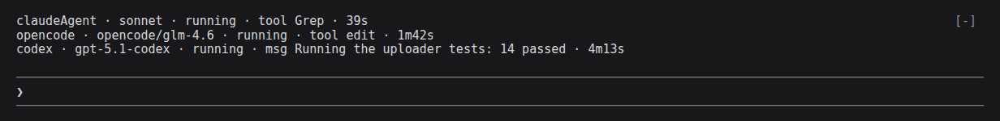
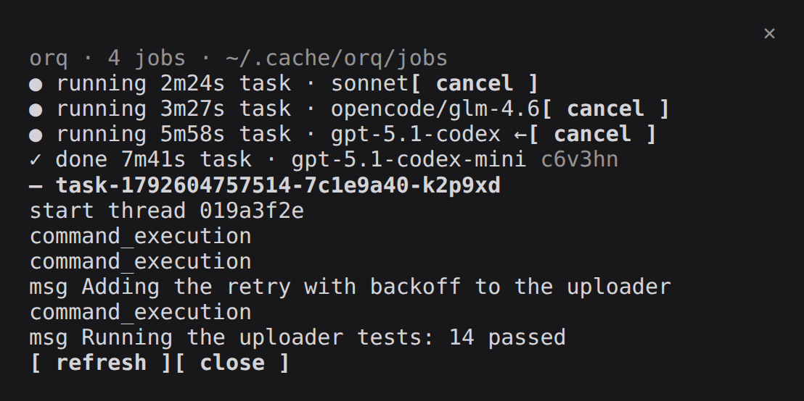
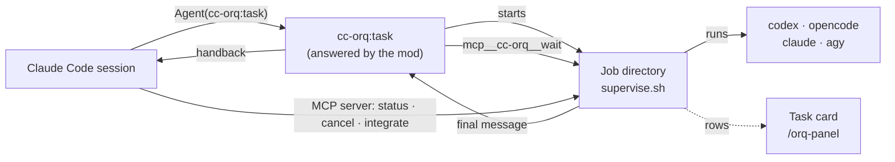

# cc-orq

[](https://github.com/Elesiann/cc-orq/actions/workflows/ci.yml)
[](LICENSE)


**Hand tasks from Claude Code to Codex, OpenCode or another Claude, and watch
them run above your prompt.**

cc-orq is a [Claude Code mod](https://code.claude.com/docs/en/plugins/mods/overview)
that brings the orchestrator of [T3 Code](https://github.com/pingdotgg/t3code)
into Claude Code. Your session delegates self-contained tasks through one agent
type, `cc-orq:task`, to the coding agent CLIs you already use. Each task runs as
a detached job in its own git worktree, under your session's permission
ceiling, and its answer comes back to the conversation when it ends.

<p align="center">
  
</p>

<sub>The screenshots use demo jobs.</sub>

## Contents

- [Features](#features)
- [Requirements](#requirements)
- [Install](#install)
- [Quick start](#quick-start)
- [Commands](#commands)
- [Delegating with cc-orq:task](#delegating-with-cc-orqtask)
- [Worktrees and integrate](#worktrees-and-integrate)
- [Tools](#tools)
- [Task card](#task-card)
- [Configuration](#configuration)
- [Child questions](#child-questions)
- [How it works](#how-it-works)
- [Troubleshooting](#troubleshooting)
- [Known limitations](#known-limitations)
- [Contributing](#contributing)
- [Credits](#credits)

## Features

- **One agent type for every worker.** `cc-orq:task` runs a task on Codex,
  OpenCode, Antigravity or the Claude CLI. The task's header names the
  provider instance and the model, so the parent session picks the right model
  for each job.
- **A permission ceiling.** A task never runs with a broader mode than the
  session that spawned it, and a driver refuses a mode it cannot enforce with a
  CLI flag.
- **Jobs that outlive the session.** Workers run detached, keep their prompt,
  events and answer on disk, and can be read, cancelled or integrated from a
  later session.
- **Worktree isolation.** A task works on its own branch in its own checkout,
  gets the ignored files your `.worktreeinclude` names, and `integrate` merges
  it back with a fast-forward or a merge commit.
- **A live view.** A card above the prompt shows each job's model, status, last
  action and timer, and `/orq-panel` lists the jobs, tails one, and cancels it.
- **An MCP server with five tools.** `capabilities`, `status`, `list`, `cancel`
  and `integrate` come from a stdio MCP server that the plugin starts, so they
  work whether or not the mod loads. `capabilities`, `status` and `cancel`
  answer in the shapes of T3 Code's orchestrator contract.
- **Questions instead of guesses.** A blocked worker writes a question and
  stops, and the parent answers it in a new task.

<p align="center">
  
</p>

## Requirements

| | Version | Why |
| --- | --- | --- |
| [Claude Code](https://code.claude.com) | 2.1.287 or newer (2.1.310 tested) | The MCP server's tools work in any session. The `cc-orq:task` agent, the card, `/orq-panel` and `/orq` are a mod, which Claude Code loads by default from 2.1.287 on and an organization can turn off |
| [Node.js](https://nodejs.org) | 22.18 or newer | The MCP server runs its TypeScript files without a build step. When `node` is missing or older, the server exits with the reason on stderr: the `cc-orq:task` agent still works, but `capabilities`, `status`, `list`, `cancel` and `integrate` are gone |
| Linux | | Jobs run under `systemd-run` or `setsid` |
| `bash`, `python3`, `git` | | The supervisor, the event extractor and worktrees |
| A provider CLI | Any of `codex`, `opencode`, `claude`, `agy` | The workers. Each one must be installed and logged in |
| [OpenCode](https://github.com/sst/opencode) | 2.0.27 (tested) | orq passes `--standalone` to `opencode run` and `opencode models` |

The five tools of the MCP server work in every session. The `cc-orq:task`
agent, the card, `/orq-panel` and `/orq` are a mod. Claude Code loads mods by
default from 2.1.287 on, and an organization can turn them off, which leaves
only the server's tools.

macOS is not supported yet: the job start script needs `systemd-run` or
`setsid` to give each job its own session, and macOS has neither by default.

## Install

```bash
claude plugin marketplace add Elesiann/cc-orq
claude plugin install cc-orq@cc-orq
```

Then run `/reload-plugins` in a running session, or start a new one.
`claude plugin install` reports that the `cardDisplay` option is not set yet.
Until you set it, the task card uses `band`; see [Task card](#task-card).

To try a checkout without installing it:

```bash
git clone https://github.com/Elesiann/cc-orq
claude --plugin-dir ./cc-orq
```

## Quick start

Ask the session to delegate, or call the agent yourself:

```
Agent({ subagent_type: "cc-orq:task", run_in_background: true, prompt: "..." })
```

The prompt starts with a header, then the task:

```
target: codex my-model effort=high
cwd: /path/to/repo

Add a retry with exponential backoff to the S3 uploader and cover it with tests.
```

The MCP server sends the session its instructions, so the session reads
`mcp__plugin_cc-orq_orq__capabilities` for the live model ids before it names a
target, and the description of the `cc-orq:task` agent tells it how to write the
prompt. The job appears on the card. When it ends, the answer comes back with a
footer that carries its `taskId`, and `mcp__plugin_cc-orq_orq__integrate` merges
the task's branch into your checkout.

## Commands

`/orq` takes one subcommand. `list` prints a table, `result` prints a job's
answer, and `cancel` and `launch` print one line.

### `/orq list`

Shows the 50 newest jobs with their `id`, `kind`, `status`, `elapsed` and `cwd`.
Status is `running`, `cancelling`, `waiting`, `interrupted`, `done`, `failed` or
`cancelled`. A `waiting` job has a non-blank `question.txt`, its supervisor is still
running, and it waits for an answer (see [Child questions](#child-questions)). An `interrupted` job has no `exit` file and no
live supervisor. A finished job keeps the elapsed time it had when its `exit` file
was written.

```
/orq list
```

### `/orq result JOB_ID`

Prints the final message of a finished job, followed by a footer with its kind,
model, effort, duration, token counts, job id (`taskId`) and session id. The effort is the
one a Codex job's rollout reports, else the one the task gave the CLI, else `n/a`. The footer shows `tokens
n/a` when the CLI's event stream reports no counts. A failed job prints its exit code and
the last 20 stderr lines, with secrets redacted. A job that exits 0 after asking a
question gets the question instead (see [Child questions](#child-questions)). A job
that has not ended gets one line that says it is running, cancelling, waiting or
interrupted.

```
/orq result manual-1760000000000-manual-k3j9x2
```

### `/orq cancel JOB_ID`

Asks the job's supervisor to stop it. The supervisor sends SIGTERM to the job's
process group, sends SIGKILL after 5 seconds, and records exit code 124. The
command only writes the request, so the job may show `cancelling` for a few
seconds. A job that has already ended is not touched: the command answers that it
finished and writes nothing. An `interrupted` job has no supervisor to stop, so the
command says so and writes nothing.

```
/orq cancel manual-1760000000000-manual-k3j9x2
```

### `/orq launch INSTANCE MODEL -- PROMPT`

Starts a job for one instance from `instances`, in the session's working
directory. Everything after ` -- ` is the prompt. The command prints
`orq: launched JOB_ID`, or the reason it refused the launch. Replace `my-model`
with a model your provider CLI accepts.

```
/orq launch codex my-model -- Run the test suite and list the failing tests
```

With `--worktree` before the instance, the job runs in its own git worktree.
See [Worktrees and integrate](#worktrees-and-integrate).

A manual launch is not under the permission ceiling of `cc-orq:task`: it uses
each provider CLI's own defaults for sandbox, permissions and reasoning effort.

## Delegating with cc-orq:task

The main session starts a task with one agent type:

```
Agent({ subagent_type: "cc-orq:task", run_in_background: true, prompt: HEADER + TASK })
```

The prompt starts with header lines, in any order, then the task. The first
line that is not a header starts the task text.

```
target: codex my-model effort=high runtime=auto-accept-edits
cwd: /path/to/repo
isolation: worktree
role: review

Review the diff on this branch and list the risks.
```

- `target: INSTANCE MODEL [effort=VALUE] [runtime=MODE] [interaction=MODE]`
  (required). `INSTANCE` is an `id` from `instances`. `MODEL` is passed to the
  CLI as written; orq does not check it against a catalog. `effort` is the
  reasoning effort, one word. Codex, Claude and Antigravity get it as a CLI
  flag. OpenCode does not, since its CLI takes an effort only inside the model
  name, as `provider/model#variant`. `runtime` and `interaction` narrow the session;
  they never widen it. Any other `key=value` is refused.
- `cwd: /absolute/path` (required): an existing directory, inside the session's
  working directory or an `allowedRoots` entry (see "Working directory").
- `isolation: worktree | shared` (default `worktree`). `worktree` runs the task
  in its own git worktree on a new branch; see "Worktrees and integrate". `cwd`
  must then be inside a git checkout, or the task is refused with
  `not_a_repository`. `shared` runs the task in `cwd` as it is.
- `role: implementation | research | review | design | test | general`
  (optional). Any role except `general` prefixes the task with
  `Act as the ROLE sub-agent for this task.`
- A refused header answers the subagent with the refusal text, and nothing runs.
  Every refusal starts with `orq: task refused (taskId none):`, so no job id is
  given for a refused task. A refusal from the ceiling or the driver names its
  code, such as `runtime_mode_unsupported`.

### Permission ceiling

The parent session's permission mode sets the most a task may do. The mode
comes only from the `Agent` call that spawned that task. When that call set no
mode, the ceiling is `approval-required` with interaction `default`, and the
debug log says `orq: ceiling for AGENT_ID: no permission mode captured at spawn`.
The session's last `cc-orq:task` mode and `permissions.defaultMode` in settings never
raise a task's ceiling.

| Parent permission mode | Runtime ceiling | Interaction ceiling |
| --- | --- | --- |
| `plan` | `approval-required` | `plan` |
| `default` | `approval-required` | `default` |
| `acceptEdits` | `auto-accept-edits` | `default` |
| `auto` | `auto` | `default` |
| `dontAsk` | `approval-required` | `default` |
| `bypassPermissions` | `full-access` | `default` |
| none, or any other value | `approval-required` | `default` |

### Working directory

`cwd` is resolved through symlinks (`realpath`), and the resolved path must lie
inside the session's working directory or inside one of the `allowedRoots` in
the configuration. A path outside both is refused with `cwd_out_of_scope`, and
the answer names the roots. A symlink is judged where it points, so a link inside
the session that points elsewhere is refused. A path that does not exist, or is
not a directory, is refused too.

Runtime modes rise in this order: `approval-required`, `auto-accept-edits`,
`auto`, `full-access`. A task that asks for a broader mode than its ceiling is
refused with `runtime_mode_escalation_denied`; `interaction=default` under a
`plan` ceiling is refused with `interaction_mode_escalation_denied`.

Not every driver can enforce every runtime mode with a flag. A mode it cannot
enforce is refused with `runtime_mode_unsupported`, so a task never runs with a
CLI default broader than the ceiling.

| Driver | `approval-required` | `auto-accept-edits` | `auto` | `full-access` | `interaction=plan` |
| --- | --- | --- | --- | --- | --- |
| `codex` | `-s read-only` | `-s workspace-write` | `--approve-for-me` | `-s danger-full-access --dangerously-bypass-approvals-and-sandbox` | refused |
| `opencode` | `--agent plan` | refused | `--auto` | refused | `--agent plan` |
| `antigravity` | `--sandbox` | `--mode accept-edits` | `--mode accept-edits` (narrower) | `--dangerously-skip-permissions` | adds `--mode plan` |
| `claudeAgent` | `--permission-mode manual` | `--permission-mode acceptEdits` | `--permission-mode auto` | `--permission-mode bypassPermissions` | `--permission-mode plan` |

Supported runtime modes per driver: `codex`, `antigravity` and `claudeAgent`
support all four; `opencode` supports `approval-required` and `auto`. The
`claudeAgent` `approval-required` row pins `--permission-mode manual`, so the
`permissions.defaultMode` in the user's settings cannot widen the child. The
`codex` `auto` row sends `--approve-for-me` without `-s`, because the CLI refuses
the pair; its sandbox follows the Codex config.

### Handback

How a finished task is delivered reads the mode in this order: the task's own
spawn, then the session's last `cc-orq:task` spawn, then `permissions.defaultMode`
in settings. This choice only sets the format of the answer. It never changes
the ceiling above.

A task's job runs detached. The subagent waits on it through `mcp__cc-orq__wait`,
one call per `waitSeconds` slice, and each call answers `finished`,
`still running, DURATION` or `supervisor gone`.

When the job ends, the answer goes back to the parent:

- Under `auto` permission mode, through a `SubagentHandback({ message })` call.
  A second step after that answers with text, so the report is handed back once.
- Under any other mode, as the subagent's text.

When the mode cannot be read, the answer is text and the debug log says
`orq: handback skipped for AGENT_ID: no permission mode`.

The answer of a finished job ends with a footer that names the job: `taskId JOB_ID`
is the id to pass to the job tools, and `session` is the provider's session id. orq has no
environment-variable opt-out for the handback, because environment variables do
not reach the mod.

Stopping the subagent with `TaskStop` writes the job's `cancel` file, so the
supervisor stops the job.

## Worktrees and integrate

A task that runs in a worktree works in its own checkout, so it cannot change
the files you are editing. Its worktree is `REPO_PARENT/REPO_NAME-wt/JOB_ID`,
beside the checkout it came from, on a new branch `orq/JOB_ID` cut from that
checkout's HEAD when the job started.

A task whose `cwd` is a subdirectory of its checkout runs in the same
subdirectory of the worktree. For an `cc-orq:task`, the whole checkout must lie
inside the session directory or an `allowedRoots` entry, since the worktree
copies all of it; otherwise the task is refused with `cwd_out_of_scope`. A
`cwd` that is not in the checkout's HEAD, such as an untracked directory, has
no counterpart in the worktree, so the task is refused and the worktree is
removed. orq creates the worktree with the checkout's git hooks and fsmonitor
turned off. `integrate` runs git in your checkout as you would, so the
checkout's own hooks run there.

### Files a worktree needs

A worktree holds the tracked files only. To give each task the ignored files
it needs to build and test, such as `node_modules` or generated code, list them
in a `.worktreeinclude` file at the root of the checkout, the file Claude Code
reads for its own worktrees. It uses `.gitignore` syntax, and a file is copied
when it matches a pattern and is also gitignored, so tracked files are never
duplicated:

```
node_modules/
.claude-plugin/types/
```

orq copies the files before the task starts, and the copy is all or nothing:
it stages the files beside the worktree and moves them in only once the copy is
complete, so one that fails, is stopped, or is still running after about 4.5
minutes leaves the worktree as git made it, and the debug log says why. A few
rules differ from a plain copy:

- A file counts as ignored when the `.gitignore` files of the commit the
  worktree holds ignore it, so a line you have not committed yet does not make
  it eligible, and nothing copied shows up as untracked in the worktree.
- A symlink is copied as a symlink, never followed. An absolute link, such as
  one `npm link` made, still points where it pointed, so a worker writing
  through it writes there.
- A path below a symlink, in the checkout or in the worktree, and an untracked
  nested repository, are skipped.
- Files keep their mode and modification time, and new directories keep their
  mode. A directory copied without write permission for its owner makes
  `git worktree remove` fail on that worktree until you `chmod -R u+w` it.
- orq uses git's own matching, so the special case Claude Code makes for a
  `**/` pattern inside an ignored directory does not apply: name the directory
  instead.

Workers can read every copied file, so list a secret such as `.env.local` only
when the task needs it.

An `cc-orq:task` runs in a worktree unless its header says `isolation: shared`.
A manual launch asks for one with `--worktree`:

```
/orq launch --worktree codex my-model -- Add the retry to the uploader
```

The launch starts nothing and says why when the directory is not inside a git
checkout (`not_a_repository`), or when git cannot create the worktree
(`git_failed`). A shared launch, a task with `isolation: shared` or a `/orq launch`
without `--worktree`, writes into its directory, so it is refused with
`worktree_busy` while a live job runs there or in a worktree of that checkout.
A worktree launch is never refused for that.

A launch that fails after git created its worktree removes that worktree and
its branch again, on a best-effort basis. When that removal fails, the debug log
records it, and the refusal still names the launch's own failure. Remove the
leftovers by hand with `git worktree remove --force PATH` and
`git branch -D orq/JOB_ID`.

### `mcp__plugin_cc-orq_orq__integrate`

Merges a finished task's branch into the checkout the task was launched from.
The input is `taskId`, the job id, and an optional `strategy`:

- `ff-only` (the default) moves the checkout forward without a merge commit.
- `merge` makes a merge commit with `--no-ff --no-edit`, so the history records
  the task.

On success the answer gives the merged commit, the branch and the worktree. The
worktree and the branch stay. Remove them with `git worktree remove` and
`git branch -d` when you no longer need them.

The model reads one JSON string. A merge answers
`{"ok": true, "taskId": "...", "mergedSha": "...", "branch": "...", "worktree": "..."}`.
A refusal answers `{"ok": false, "error": {"code": "...", "message": "..."}}`,
and `error` also carries `files` when the code is `merge_conflict`:

```json
{"ok": false, "error": {"code": "merge_conflict", "message": "orq/JOB_ID conflicts with CHECKOUT in 1 file(s); the merge was aborted", "files": ["a.txt"]}}
```

A refusal names one of these codes:

| Code | Meaning |
| --- | --- |
| `task_not_found` | No job has that id. |
| `no_worktree` | The job ran without a worktree, so it has no branch to merge. |
| `not_a_repository` | The checkout the job was launched from is not a git checkout. |
| `dirty_worktree` | The checkout has uncommitted or untracked files. Commit or stash them, then integrate again. |
| `already_integrated` | The task branch is already in the checkout's HEAD, so there is nothing to merge. |
| `not_fast_forward` | `ff-only` cannot move HEAD, because the checkout has commits the task lacks. Integrate with `merge`, or rebase the task first. |
| `merge_conflict` | The merge stopped on conflicts. orq ran `git merge --abort`, and the answer lists the conflicted files. |
| `invalid_request` | The input does not match the schema. |
| `git_failed` | git failed in a way no other code names. The answer carries its message. |

When a merge conflicts, redelegate a rebase of the task branch to the same
worker, then integrate again. orq never forces a merge, and it never resolves a
conflict for you.

## Tools

The plugin starts a stdio MCP server, `plugin:cc-orq:orq`, that serves five
tools to the parent session, named `mcp__plugin_cc-orq_orq__capabilities`,
`mcp__plugin_cc-orq_orq__status`, `mcp__plugin_cc-orq_orq__list`,
`mcp__plugin_cc-orq_orq__cancel` and `mcp__plugin_cc-orq_orq__integrate`. They
are there whether or not the mod loads, and `/mcp` shows the server.
Each answers with a JSON text. A refusal has the shape
`{"error": {"code": "...", "message": "..."}}` and comes with `isError`, and the
codes orq answers with are `task_not_found`, `task_not_cancellable` and
`invalid_request`. A task is one job: its `taskId` is the job id that
`/orq list` shows. `integrate` is described under
[Worktrees and integrate](#worktrees-and-integrate).

The server sends its own instructions to the session, which tell it how to use
the five tools (`server/instructions.md`, under 4,000 bytes). The guidance for
starting a task is the description of the `cc-orq:task` agent, which the mod
registers (`TASK_AGENT_DESCRIPTION` in `hooks/task.ts`), so it is in the session
exactly when the mod loads. No hook injects text at session start.

The server uses the MCP SDK from `server/vendor/mcp-sdk.mjs`, a bundle that is
committed, so a user never has to install a package. `npm run build:vendor`
rebuilds it, and `node scripts/build-vendor.mjs --check` fails when the
committed file or `NOTICE` is out of date.

### `mcp__plugin_cc-orq_orq__capabilities`

Takes no input. Answers the provider instances of the configured `instances`
and the modes a task may run in. Each provider has its
`providerInstanceId`, its `driverKind`, its `models` (each with the `options`
the CLI reports, such as `reasoningEffort` and its allowed values),
`canRunChildTask` and `constraints`, the reasons it cannot run now. An
OpenCode instance lists every model of `opencode models --standalone`, which
names only the providers OpenCode can use, logged in or configured through the
environment.

<details>
<summary>Example answer</summary>

```json
{
  "parentThreadId": null,
  "inheritedProviderInstanceId": null,
  "inheritedModel": null,
  "runtimeMode": "approval-required",
  "interactionMode": "default",
  "providers": [
    {
      "providerInstanceId": "codex",
      "driverKind": "codex",
      "displayName": null,
      "models": [{ "id": "<model-id>", "label": "<label>", "options": [] }],
      "canRunChildTask": true,
      "canRunCrossProviderChildTask": true,
      "constraints": []
    }
  ],
  "features": {
    "appOwnedSubagents": true,
    "asyncPolling": true,
    "cancellation": true,
    "batchThreadCreation": false,
    "threadManagement": false,
    "incrementalThreadRead": false,
    "scheduledTasks": false,
    "maxBatchThreads": 0
  }
}
```

</details>

The probe runs `scripts/catalog.py` over the configured instances and is cached
for ten minutes. A probe that fails answers no providers, logs the reason on
stderr, and is run again on the next call. The server does not know the
permission mode of the session yet, so `runtimeMode` and `interactionMode` are
what an unknown mode gives, `approval-required` and `default`. They do not
follow the session, and the ceiling of a `cc-orq:task` is still its parent's
mode (see [Permission ceiling](#permission-ceiling)).

### `mcp__plugin_cc-orq_orq__status`

Takes `{"taskId": "<id>"}` and reads that job's directory, so it also answers for
jobs of earlier sessions. An unknown or unsafe id answers `task_not_found`.

<details>
<summary>Example answer</summary>

```json
{
  "taskId": "manual-1760000000000-manual-k3j9x2",
  "status": "completed",
  "workState": "result_available",
  "kind": "manual",
  "startedAtIso": "2026-10-19T12:00:00.000Z",
  "finishedAtIso": "2026-10-19T12:02:05.000Z",
  "instanceId": "codex",
  "model": "<model-id>",
  "result": "The answer."
}
```

</details>

`result` is set for a completed task. `error` is set for a failed task (its exit
code and the redacted stderr tail) and for an interrupted one. `finishedAtIso`
is set once the job has ended. `instanceId` and `model` are set when the job
recorded them.

| `status` | Meaning |
| --- | --- |
| `queued` | Reserved; orq does not produce it yet. |
| `running` | The supervisor is alive. A task with a cancel request stays `running` until the supervisor stops it. |
| `waiting` | The task wrote a question to `question.txt` and its supervisor is still alive. See [Child questions](#child-questions). |
| `completed` | Exit 0, a non-empty final message, and no error in the event stream. A task that exited 0 after writing a question is `completed`, and its `result` is the `BLOCKED on a question (taskId ID): ...` text. |
| `failed` | Any other end: a non-zero exit, an empty final message, or an error in the event stream. |
| `cancelled` | Exit 124, after a cancel request. |
| `interrupted` | The supervisor is gone and the job left no exit file. |

`workState` is `working` while the task runs or waits on its question, and
`result_available` once the task has ended. orq does not produce
`waiting_for_children`, since a task has no children of its own.

### `mcp__plugin_cc-orq_orq__list`

Takes `{"limit": N}`, an optional whole number from 1 to 50 that defaults to
20, and answers `{"jobs": [...]}`: the newest jobs first, whatever started them,
read from the jobs directory. A `limit` that is not a whole number from 1 to 50
answers `invalid_request`. Each job is one row:

```json
{
  "taskId": "task-1760000000000-a1b2c3d4-k3j9x2",
  "status": "completed",
  "kind": "task",
  "instanceId": "codex",
  "model": "<model-id>",
  "startedAt": "2026-10-19T12:00:00.000Z",
  "durationMs": 125000,
  "cwd": "/path/to/repo-wt/task-1760000000000-a1b2c3d4-k3j9x2",
  "branch": "orq/task-1760000000000-a1b2c3d4-k3j9x2",
  "parent": null,
  "question": false
}
```

`status` is the one of the `status` tool. `durationMs` runs to the job's `exit`
file, or to now while the job runs, and is `null` for an interrupted job.
`instanceId`, `model` and `branch` are `null` when the job did not record them,
and `branch` is set only for a worktree job. `parent` is `null` for now.
`question` is `true` when the job ended blocked on a question. The server reads
every job's metadata, and checks whether a job is alive only for the rows it
returns.

### `mcp__plugin_cc-orq_orq__cancel`

Takes `{"taskId": "<id>", "reason": "<optional text>"}`. The reason is up to 200
characters; a longer one, or one that is not text, answers `invalid_request` and
nothing is written. orq writes it into the cancel marker as `why="..."`. A running
or waiting task answers `{"taskId": "...", "status": "cancel_requested"}` and gets
the cancel request that the supervisor acts on; it then reads `cancelled`. A task
whose cancel was already requested still reads `running`, or `waiting` when it has
written a question, and a repeated cancel answers
`cancel_requested` again and rewrites the marker with its own reason. A task that
has ended, or is `interrupted`, answers `task_not_cancellable` and nothing is written.

At session start orq logs one debug line for each job in the jobs directory
that has no exit file, with its id, kind and age.

## Task card

While jobs run, orq shows them in a card above the prompt. Each job takes one
line with five fields:

```
codex · my-model · running · msg Reading the test files · 2m15s
```

1. INSTANCE: the job's instance id. A job without one shows its runner, or its kind.
2. MODEL: the model the job was launched with, or `?` when none was recorded.
3. STATUS: the job's status, as `/orq list` shows it.
4. LAST_ACTION: the last event in the job's `events.jsonl` that orq can render. It reads `—` while there is none.
5. DURATION: the time since the job started. For a job that has ended, it is the time up to its `exit` file.

The card looks at the 50 newest jobs, as `/orq list` does. It lists a job while
the job has no `exit` file, so an `interrupted` job stays on the card. A job whose
`exit` file was written less than 60 seconds ago also stays. It leaves the card
once its `exit` file is 60 seconds old.

The card refreshes every 2 seconds. A refresh that is still running makes the
next tick skip, unless it has run for more than 60 seconds; then the next tick
starts a new refresh.

The card draws nothing when a survey holds the band, when the band gives it no
rows, when the surface is neither the terminal nor the desktop, and when no job
is listed. When the rows do not fit the band, the card draws the newest rows and
a last row, `+N more`, that counts the rest. A band of one row shows the newest
job with the count in front, `(+N more) codex · …`, so a long line keeps it.

Each refresh writes the rows to the session state `cc-orq.card`, and the band draws
from there without reading a file. The state outlives a reload of the plugin, so
the card stays on screen until the next refresh.

`/clear` and a resume keep the card running. Any other end of the session, such
as `/exit`, a logout, or a `-p` run that finishes, stops it.

### Setting `cardDisplay`

`cardDisplay` takes one of three values:

- `band`: the card draws above the prompt. This is the default.
- `status`: the card goes to the status line under the prompt. It shows the newest
  job's line, followed by ` (+N more)` when more jobs are listed. The line is
  cleared when the card stops, and a refresh with no jobs clears a line that an
  earlier run left behind.
- `off`: no card is drawn, and no refresh timer runs.

An unknown value counts as `band`. Set it in `/config`, or in `settings.json`
under `pluginConfigs.cc-orq.options.cardDisplay`.

### `/orq-panel`

`/orq-panel [show <id> | cancel <id>]` opens a pane with the 50 newest jobs. Each
job is one row, with its status, elapsed time, kind and model. The pane redraws
every 2 seconds while it is open. Its timer stops when the pane closes, and at
the end of the session as the card's does.

- A running or waiting job has a `cancel` button. It asks the supervisor to stop
  the job, as `/orq cancel` does.
- Pressing a job's row selects it. The pane then shows the last 30 rendered lines
  of that job's `events.jsonl`, read from its last 32 KB.
- `show <id>` selects a job and opens the pane. `cancel <id>` cancels a running
  or waiting job without opening the pane.

The pane also has `refresh` and `close` buttons.

## Configuration

orq reads `~/.config/orq/config.json` when it exists. Every field is optional.

```json
{
  "jobsDir": "~/.cache/orq/jobs",
  "waitSeconds": 120,
  "allowedRoots": ["~/work/shared"],
  "instances": [
    { "id": "codex", "driver": "codex" },
    { "id": "opencode", "driver": "opencode" },
    { "id": "claudeAgent", "driver": "claudeAgent" },
    { "id": "codex-work", "driver": "codex", "env": { "CODEX_HOME": "~/.codex-work" } }
  ]
}
```

- `jobsDir`: where each job keeps its files, as an absolute path or one that
  starts with `~/`. Default `~/.cache/orq/jobs`.
- `waitSeconds`: how long one wait step blocks before the next one, between 10 and 240. The
  engine aborts a subagent silent for 600 s, so orq keeps each wait under 240 s. Default 120.
- `allowedRoots`: directories, as absolute paths or paths that start with `~/`,
  where an `cc-orq:task` may run besides the session's own working directory. A
  `cwd` must resolve inside one of them. Default: none. Entries that are not
  absolute are dropped with a warning in the debug log.
- `instances`: the provider instances the parent can target. `id` is the name
  used in a task's `target:` line (letters, digits, `_`, `.`, `-`, up to 64
  characters, unique), `driver` is one of `codex`, `opencode`, `antigravity`,
  `claudeAgent`, and `env` holds variables passed to that instance's process,
  with `UPPER_CASE` keys and string values. A leading `~` in `jobsDir` or in an
  `env` value expands to your home. Defaults: `codex`, `opencode` and
  `claudeAgent`.

A file that is not valid JSON falls back to the defaults. A valid file with an
invalid field keeps the default for that field and drops invalid instances one
by one. Both cases log a warning naming the field in the debug log
(`claude --debug-file`).

## Job directory layout

<details>
<summary>Files in a job directory, and what the exit code means</summary>

Each job gets its own directory, `<jobsDir>/<id>`. The job id has the form
`<kind>-<start in ms>-<agent suffix>-<random>`. A manual launch uses `manual`
for both the kind and the agent suffix, for example
`manual-1760000000000-manual-k3j9x2`.

| File | Written by | Contents |
| --- | --- | --- |
| `meta.json` | `/orq launch` | The job's id, kind, agent id, working directory, start time, runner, model, instance id, driver, the effort the CLI was given and, for a Codex instance with a `CODEX_HOME`, that path. A worktree job adds the checkout it came from (`repo`), the base commit (`baseSha`), its branch and its worktree path. Other `env` values are never written to disk. |
| `prompt.txt` | `/orq launch` | The prompt, as given. |
| `scope` | start script | `systemd` when the job runs in a transient user unit, `setsid` when no user manager is reachable. |
| `child.log` | start script | The supervisor's own stdout and stderr. |
| `pgid` | `supervise.sh` | The supervisor's pid. The supervisor leads its process group, so this is also the group id. |
| `events.jsonl` | `supervise.sh` | The CLI's stdout. For the supported runners it is a JSON event stream. |
| `stderr.txt` | `supervise.sh` | The CLI's stderr. |
| `last.txt` | the CLI or `supervise.sh` | The final message. Codex writes it with `-o`. The other runners extract it from the event stream after the run. |
| `cancel` | `/orq cancel` | A request to stop the job. Only its existence counts. |
| `exit` | `supervise.sh`, or `/orq launch` when the supervisor does not start | The exit code, described below. |
| `question.txt` | the job, through the shell or the `orq_ask` tool | The question for the parent, written before the job stops. A job with a non-blank file, no `exit`, and a running supervisor is `waiting`. |
| `flags` | `cc-orq:task` | Optional. Written by a task launch from the permission ceiling and the effort. Each non-empty line becomes one extra argument to the CLI. |

The `exit` file holds one number:

- `0`: the CLI finished. The job is `done` when `last.txt` holds a non-empty final message and the event extractor reports no error. Otherwise it is `failed`. A job that left a non-blank `question.txt` is `done` even when `last.txt` is empty.
- `124`: the job was cancelled.
- `125`: the supervisor did not start, so the job never ran.
- Any other number: the CLI's own exit code. The job is `failed`.

A file that does not hold one whole number, an empty file for example, counts as `failed`. `/orq list` and `/orq result` apply this same rule, so a job shows the same status in both.

A `meta.json` without `runner` takes the runner of its `driver`. A job with neither
skips the event extraction, so it is `done` when its exit is 0 and `last.txt` is not empty.

A job without an `exit` file is `waiting` while its process group, named in `pgid`,
still exists and its `question.txt` is non-blank. Otherwise it is `running` while
that group exists. When the group is gone, `/orq list` shows the job as `interrupted`
and leaves its elapsed time as `—`, whether or not it wrote a question.

</details>

## Child questions

A job that is blocked on something its brief does not answer asks its parent
instead of guessing. orq sets `ORQ_JOB_DIR` to the job's own directory in every
job's environment. The job writes its question to `$ORQ_JOB_DIR/question.txt`,
prints `BLOCKED:` followed by the question as its final message, and stops.

- While `question.txt` is non-blank, the job has no `exit` file, and its supervisor
  still runs, `/orq list` shows the job as `waiting`, and `/orq result` says it is
  waiting for an answer.
- When the job exits 0 after writing a non-blank question, it is `done`, and `/orq result`
  prints `BLOCKED on a question`, with the question. The parent answers it in a new
  task that carries the original brief plus the answer.
- A job that fails or is cancelled keeps its failed or cancelled answer, even when
  it left a question.

Every `cc-orq:task` and `/orq launch` prompt ends with the protocol paragraph, `QUESTION_PROTOCOL` in
`hooks/question.ts`. A Codex or Claude worker writes its question with its shell
tool:

```bash
printf '%s\n' 'Which database should the migration target?' > "$ORQ_JOB_DIR/question.txt"
```

An OpenCode worker can call the `orq_ask` tool instead. The tool is in
`opencode/tools/orq_ask.ts`. OpenCode loads custom tools from
`~/.config/opencode/tools/`, so link it there once:

```bash
mkdir -p ~/.config/opencode/tools
ln -s /path/to/cc-orq/opencode/tools/orq_ask.ts ~/.config/opencode/tools/orq_ask.ts
```

The tool writes the same file. Without the link, an OpenCode worker still has its
shell tool, and the paragraph works the same way.

Limit: when a job's supervisor dies after it wrote a question, no `exit` file
follows, so the job is `interrupted`. `/orq result` reports the interruption and
does not show the question, although the question stays in `question.txt`.

## How it works

`hooks/register.ts` wires the modules to the engine's events. On
`session.start` it reads the configuration, registers `/orq` and `/orq-panel`,
the `cc-orq:task` agent type and the `wait` tool, and starts the task card; on
`session.end` it stops the card and the pane. The five other tools are served by
the MCP server in `server/`, which Claude Code starts from the `mcpServers` entry
of `.claude-plugin/plugin.json`.

A delegated task takes this path:



1. The parent calls `Agent` with `subagent_type: "cc-orq:task"`. On
   `agent.spawn`, `hooks/task.ts` records the permission mode of that call,
   which sets the task's ceiling.
2. The subagent's first `turn.step` parses the header (`hooks/task-header.ts`),
   resolves the target and the CLI flags under the ceiling (`hooks/target.ts`),
   and starts a job through the engine. No model call happens for the
   subagent: the mod answers each of its steps itself.
3. The engine (`hooks/engine.ts`) creates the job directory, a worktree when the
   task asks for one (with the git commands `hooks/worktree.ts` plans), and runs `scripts/supervise.sh`
   detached under `systemd-run` or `setsid`. The supervisor runs the provider
   CLI, writes its events and final message, and stops the process group when
   a `cancel` file appears. An OpenCode job passes `--standalone`, so it runs on
   a private OpenCode server with the job's environment, not on OpenCode's
   shared background service, and a cancel sends it SIGINT first, so OpenCode
   aborts the session and the shared service does not resume it later. When
   the CLI is gone, finished or cancelled, `scripts/sweep.py` ends any process
   that still carries the job's `ORQ_JOB_DIR`, such as an MCP server that was
   still starting.
4. Each following step calls `mcp__cc-orq__wait`, which blocks for up to
   `waitSeconds` and answers whether the job has finished.
5. When the job ends, the engine reads its final message from `last.txt` and
   its token counts and errors from the event stream (`scripts/extract.py`),
   and the subagent hands the answer back to the parent.

Beside that path, `server/main.mjs` starts the MCP server, which serves
`capabilities`, `status`, `list`, `cancel` and `integrate` (`server/tools.ts`)
over stdio on the same job core: `hooks/tools.ts` answers three of them (the
provider probe is `scripts/catalog.py`), `hooks/integrate.ts` merges a task's
branch, and `server/node-engine.ts` gives them the engine's `$` in plain Node.
`hooks/card.ts` and `hooks/panel.ts` draw the card and the pane from the job
directories.

## Troubleshooting

| You see | Do this |
| --- | --- |
| `/orq`, the task card or `mcp__cc-orq__wait` are missing | Check that your Claude Code is 2.1.287 or newer, that your organization has not turned mods off, and that `cc-orq` is enabled in `/plugin`, then run `/reload-plugins` |
| The `mcp__plugin_cc-orq_orq__*` tools are missing, or `/mcp` shows `plugin:cc-orq:orq` as failed | Check that `cc-orq` is enabled in `/plugin`. The server writes the reason for a failed start to stderr: `the orq server needs Node 22.18 or newer` means the `node` on your PATH is older; `node --version` shows which one Claude Code finds |
| `capabilities` lists no providers, or misses one | Run the provider CLI once in a shell and log in. The debug log (`claude --debug-file`) gives the probe's reason |
| `orq: task refused (taskId none): ...` | The refusal names its code. See [Permission ceiling](#permission-ceiling) and [Working directory](#working-directory) |
| A job reads `interrupted` | Its supervisor died without writing an exit code, for example on a reboot. Its files stay in the job directory |
| `integrate` answers `not_fast_forward` | Integrate again with `"strategy": "merge"` |
| `integrate` answers `merge_conflict` | Delegate a rebase of the task branch to the same worker, then integrate again |
| A worker's build or tests fail in its worktree for a missing dependency | List the ignored files it needs, such as `node_modules/`, in `.worktreeinclude`. See [Files a worktree needs](#files-a-worktree-needs) |
| The card does not show | The surface must be the terminal or the desktop app, and `cardDisplay` must not be `off` |

## Known limitations

- Linux only. macOS has neither `systemd-run` nor `setsid` by default.
- A task cannot be resumed or sent a follow-up message. A review round or an
  answer to a child's question is a new task that carries the earlier brief.
- Cancelling a job stops its process group. A process that leaves the group
  keeps running.
- OpenCode tasks do not get the task's effort, and their footer says
  `effort n/a`.
- A task's worktree gets ignored files only through `.worktreeinclude`, and a
  large copy, such as a big `node_modules`, delays the task's start.
- In `claude -p`, Claude Code stops background agents after about 11 minutes,
  so a longer task loses its subagent. The job itself keeps running and its
  result stays readable through `/orq result` and `status`.
- The task card and `/orq-panel` draw only in the terminal and the desktop app.

## Contributing

Issues and pull requests are welcome. See [CONTRIBUTING.md](CONTRIBUTING.md)
for the setup, the checks to run and the rules, and
[SECURITY.md](SECURITY.md) to report a vulnerability. Changes are listed in
[CHANGELOG.md](CHANGELOG.md).

## Credits

- [T3 Code](https://github.com/pingdotgg/t3code) for the orchestrator design,
  the tool shapes and the orchestration instructions that cc-orq adapts (MIT).
- [Codex](https://github.com/openai/codex), [OpenCode](https://github.com/sst/opencode)
  and [Claude Code](https://code.claude.com), the workers it drives.

Notices for adapted code are in [NOTICE](NOTICE).

## License

[MIT](LICENSE)
