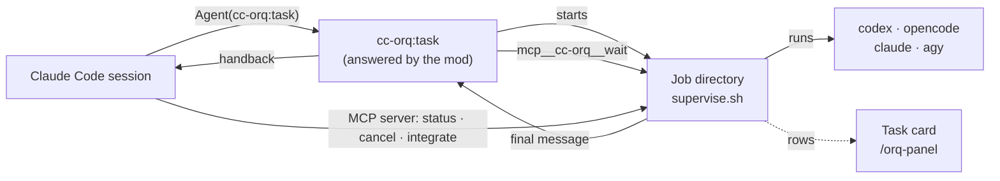

# cc-orq

[](https://github.com/Elesiann/cc-orq/actions/workflows/ci.yml)
[](LICENSE)


**Hand tasks from Claude Code to Codex, OpenCode or another Claude, and watch
them run above your prompt.**

cc-orq is a Claude Code plugin that brings the orchestrator of [T3 Code](https://github.com/pingdotgg/t3code)
into Claude Code. The session calls the `delegate` tool to hand a self-contained
task to the coding agent CLIs you already use. In the Claude Code CLI, `delegate`
returns an MCP task that `/tasks` lists and that wakes the session with the
worker's answer when the task ends. Each task runs as a detached job in its own
git worktree, under a permission ceiling. The `cc-orq:task` agent starts the same
kind of job through the Agent tool, and its answer comes back to the conversation
when the task ends. The MCP server works in every session. The task card,
`/orq-panel` and `/orq` come from a [Claude Code mod](https://code.claude.com/docs/en/plugins/mods/overview),
which Claude Code loads by default from 2.1.287.

<p align="center">
  
</p>

<sub>The screenshots use demo jobs.</sub>

## Contents

- [Features](#features)
- [Requirements](#requirements)
- [Install](#install)
- [Quick start](#quick-start)
- [Commands](#commands)
- [Delegating with cc-orq:task](#delegating-with-cc-orqtask)
- [Permission ceiling](#permission-ceiling)
- [Worktrees and integrate](#worktrees-and-integrate)
- [Tools](#tools)
- [Task card](#task-card)
- [Configuration](#configuration)
- [Child questions](#child-questions)
- [Leaving and coming back](#leaving-and-coming-back)
- [How it works](#how-it-works)
- [Upgrading from 0.1](#upgrading-from-01)
- [Troubleshooting](#troubleshooting)
- [Known limitations](#known-limitations)
- [Contributing](#contributing)
- [Credits](#credits)

## Features

- **One agent type for every worker.** `cc-orq:task` runs a task on Codex,
  OpenCode, Antigravity or the Claude CLI. The task's header names the
  provider instance and the model, so the parent session picks the right model
  for each job.
- **A permission ceiling.** A task never runs with a broader mode than your
  `ceiling` configuration allows, nor, while the hook that reads the session's
  permission mode runs, than that mode allows. A driver refuses a mode it cannot
  enforce with a CLI flag. In the CLI, a request above the ceiling opens a form
  that asks you to allow it for that one task.
- **Jobs that outlive the session.** Workers run detached, keep their prompt,
  events and answer on disk, and can be read, cancelled or integrated from a
  later session.
- **Delegation as a native task.** In the Claude Code CLI, `delegate` answers
  with an [MCP task](https://code.claude.com/docs/en/mcp#mcp-tasks-that-run-on-the-server).
  `/tasks` lists it with the worker's model and last action, the footer counts
  it, and the session wakes by itself with the worker's answer. A client without
  tasks gets the job's id and reads it with `status`.
- **Worktree isolation.** A task works on its own branch in its own checkout,
  gets the ignored files your `.worktreeinclude` names, and `integrate` merges
  it back with a fast-forward or a merge commit.
- **A live view.** A card above the prompt shows each job's model, status, last
  action and timer, and `/orq-panel` lists the jobs, tails one, and cancels it.
- **An MCP server with seven tools.** `capabilities`, `delegate`, `answer`,
  `status`, `list`, `cancel` and `integrate` come from a stdio MCP server that
  the plugin starts, so they work whether or not the mod loads. `capabilities`,
  `status` and `cancel` answer in the shapes of T3 Code's orchestrator contract.
- **Questions instead of guesses.** A blocked worker writes a question and
  stops, and `answer` resumes that same worker with the reply, in its own
  session, worktree and branch, instead of starting it again from the brief.

<p align="center">
  
</p>

## Requirements

| | Version | Why |
| --- | --- | --- |
| [Claude Code](https://code.claude.com) | 2.1.287 or newer (2.1.310 tested) | The MCP server's tools work in any session. The `cc-orq:task` agent, the card, `/orq-panel` and `/orq` are a mod, which Claude Code loads by default from 2.1.287 on and an organization can turn off |
| [Node.js](https://nodejs.org) | 22.18 or newer | The MCP server runs its TypeScript files without a build step. When `node` is missing or older, the server exits with the reason on stderr: the `cc-orq:task` agent still works, but `capabilities`, `delegate`, `answer`, `status`, `list`, `cancel` and `integrate` are gone |
| Linux or macOS | | Linux is the supported platform. macOS is experimental; see [macOS (experimental)](#macos-experimental). Jobs run under `systemd-run` or `setsid`, or under `python3` where there is neither |
| `bash`, `python3`, `git`, `pgrep` | | The supervisor, the event extractor, worktrees, and the hook that reads the session's permission mode. `pgrep` comes from procps; the supervisor uses it to find its watcher's `sleep`. Without it the sweep ends that `sleep` and `child.log` gets a line saying so |
| A provider CLI | Any of `codex`, `opencode`, `claude`, `agy` | The workers. Each one must be installed and logged in |
| [OpenCode](https://github.com/sst/opencode) | 2.0.27 (tested) | orq passes `--standalone` to `opencode run` and `opencode models`, so the flag is required. Earlier versions were not tried. See [OpenCode notes](#opencode-notes) |

The seven tools of the MCP server work in every session. The `cc-orq:task`
agent, the card, `/orq-panel` and `/orq` are a mod. Claude Code loads mods by
default from 2.1.287 on, and an organization can turn them off, which leaves
only the server's tools.

`delegate` answers with an MCP task only when the request declares the tasks
extension. Claude Code 2.1.310 declares it for a call from the main conversation
of the interactive CLI, and does not for a call from a subagent (both measured:
the subagent's call got `{"taskId", "status": "running"}` and left no task
record). Claude Code's documentation adds an Agent SDK or stream-json session
with `CLAUDE_AUTO_BACKGROUND_TASKS=1`, and says the VS Code extension and the
desktop app have no MCP tasks; those are not tested here. Any other call gets the
job's id and no task: see [`delegate`](#mcp__plugin_cc-orq_orq__delegate).

### macOS (experimental)

macOS is experimental and tested only in CI. The test suites run on
`macos-latest` with fake workers, and nobody has run a job there with a real
provider CLI.

macOS has neither `systemd-run` nor `setsid`, so the start script runs the
supervisor through `python3`, which calls `os.setsid()` and then `exec`. The
job's `scope` file says `python-setsid`. The supervisor runs under the `bash`
3.2 that macOS ships.

What does not work on macOS:

- The sweep. It reads `/proc`, which macOS does not have, so it ends nothing.
  A cancel still ends the job's process group, but a process that a CLI left
  outside the group keeps running.

## Install

```bash
claude plugin marketplace add Elesiann/cc-orq
claude plugin install cc-orq@cc-orq
```

Then run `/reload-plugins` in a running session, or start a new one.
`claude plugin install` reports one user option not yet set. That option is
`cardDisplay`, and until you set it the task card uses `band`; see
[Task card](#task-card).

To try a checkout without installing it:

```bash
git clone https://github.com/Elesiann/cc-orq
claude --plugin-dir ./cc-orq
```

## Quick start

Ask the session to delegate, or call the agent yourself:

```
Agent({ subagent_type: "cc-orq:task", run_in_background: true, prompt: "..." })
```

The prompt starts with a header, then the task:

```
target: codex my-model effort=high
cwd: /path/to/repo

Add a retry with exponential backoff to the S3 uploader and cover it with tests.
```

The MCP server sends the session its instructions, so the session reads
`mcp__plugin_cc-orq_orq__capabilities` for the live model ids before it names a
target, and the description of the `cc-orq:task` agent tells it how to write the
prompt. The job appears on the card. When it ends, the answer comes back with a
footer that carries its `taskId`, and `mcp__plugin_cc-orq_orq__integrate` merges
the task's branch into your checkout.

The session can call `mcp__plugin_cc-orq_orq__delegate` instead, with the header
fields as JSON. In the CLI the call returns at once with a background task: `/tasks`
lists it until the worker ends, and the session wakes with the answer. Only
`delegate` creates a `/tasks` entry; the `cc-orq:task` agent shows on the card.
In the `default` permission mode, Claude Code asks once before it calls each
tool, so a first delegation shows two approval prompts, one for `capabilities`
and one for `delegate`.

## Commands

`/orq` takes one subcommand. `list` prints a table, `result` prints a job's
answer, and `cancel` and `launch` print one line.

### `/orq list`

Shows the 50 newest jobs with their `id`, `kind`, `status`, `elapsed` and `cwd`.
Status is `running`, `cancelling`, `waiting`, `interrupted`, `done`, `failed` or
`cancelled`. A `waiting` job has a non-blank `question.txt`, its supervisor is still
running, and it waits for an answer (see [Child questions](#child-questions)). An `interrupted` job has no `exit` file and no
live supervisor. A finished job keeps the elapsed time it had when its `exit` file
was written.

```
/orq list
```

### `/orq result JOB_ID`

Prints the final message of a finished job, followed by a footer with its kind,
model, effort, duration, token counts, job id (`taskId`) and session id. The effort is the
one a Codex job's rollout reports, else the one the task gave the CLI, else `n/a`. The footer shows `tokens
n/a` when the CLI's event stream reports no counts. A failed job prints its exit code and
the last 20 stderr lines, with secrets redacted. A job that exits 0 after asking a
question gets the question instead (see [Child questions](#child-questions)). A job
that has not ended gets one line that says it is running, cancelling, waiting or
interrupted.

```
/orq result manual-1760000000000-manual-k3j9x2
```

### `/orq cancel JOB_ID`

Asks the job's supervisor to stop it. The supervisor looks for the request every
2 seconds, and then:

1. For an OpenCode job, sends SIGINT to the OpenCode client and waits up to 3
   seconds for it to end. SIGINT aborts the OpenCode session, which SIGTERM
   leaves claimed. A client that is still running after that gets one line in
   `child.log`, and the cancel goes on.
2. If the CLI is still running, sends SIGTERM to the job's process group.
3. When the CLI has ended, or when it is still running 5 seconds after the
   SIGTERM, ends every process that still carries the job's `ORQ_JOB_DIR`,
   records exit code 124, and sends SIGKILL to the process group.

The command only writes the request, so the job may show `cancelling` for a few
seconds, and for up to about 11 when the CLI ends on neither SIGINT nor SIGTERM.
A job that has already ended is not touched: the command answers that it finished
and writes nothing. An `interrupted` job has no supervisor to stop, so the command
says so and writes nothing.

```
/orq cancel manual-1760000000000-manual-k3j9x2
```

### `/orq launch INSTANCE MODEL -- PROMPT`

Starts a job for one instance from `instances`, in the session's working
directory. Everything after ` -- ` is the prompt. The command prints
`orq: launched JOB_ID`, or the reason it refused the launch. Replace `my-model`
with a model your provider CLI accepts.

```
/orq launch codex my-model -- Run the test suite and list the failing tests
```

With `--worktree` before the instance, the job runs in its own git worktree.
See [Worktrees and integrate](#worktrees-and-integrate).

A manual launch is not under the permission ceiling of `cc-orq:task`: it uses
each provider CLI's own defaults for sandbox, permissions and reasoning effort.

## Delegating with cc-orq:task

The main session starts a task with one agent type:

```
Agent({ subagent_type: "cc-orq:task", run_in_background: true, prompt: HEADER + TASK })
```

The prompt starts with header lines, in any order, then the task. The first
line that is not a header starts the task text.

```
target: codex my-model effort=high runtime=auto-accept-edits
cwd: /path/to/repo
isolation: worktree
role: review

Review the diff on this branch and list the risks.
```

- `target: INSTANCE MODEL [effort=VALUE] [runtime=MODE] [interaction=MODE]`
  (required). `INSTANCE` is an `id` from `instances`. `MODEL` is passed to the
  CLI as written; orq does not check it against a catalog. `effort` is the
  reasoning effort, one word. Codex, Claude and Antigravity get it as a CLI
  flag. OpenCode does not, since its CLI takes an effort only inside the model
  name, as `provider/model#variant`. `runtime` and `interaction` narrow the session;
  they never widen it. Any other `key=value` is refused.
- `cwd: /absolute/path` (required): an existing directory, inside the session's
  working directory or an `allowedRoots` entry (see "Working directory").
- `isolation: worktree | shared` (default `worktree`). `worktree` runs the task
  in its own git worktree on a new branch; see "Worktrees and integrate". `cwd`
  must then be inside a git checkout, or the task is refused with
  `not_a_repository`. `shared` runs the task in `cwd` as it is.
- `role: implementation | research | review | design | test | general`
  (optional). Any role except `general` prefixes the task with
  `Act as the ROLE sub-agent for this task.`
- A refused header answers the subagent with the refusal text, and nothing runs.
  Every refusal starts with `orq: task refused (taskId none):`, so no job id is
  given for a refused task. A refusal from the ceiling or the driver names its
  code, such as `runtime_mode_unsupported`.

### Working directory

`cwd` is resolved through symlinks, and the resolved path must lie inside the
session's working directory or inside one of the `allowedRoots` in the
configuration. The check reads the path with `fs.stat` and its `resolve` option.
It folds each `..` into the text of the path before it follows a symlink, as
`cd -L` does, so `link/..` names the parent of the link and not the parent of
its target. A `..` that comes right after a symlink or after a missing directory
resolves by text. An `allowedRoots` entry follows the same rule. A path outside
both is refused with `cwd_out_of_scope`, and the answer names the roots that
exist. An `allowedRoots` entry that does not exist is left out of that list. A symlink is judged where it points, so a link inside the session that
points elsewhere is refused. A path that does not exist, or is not a directory,
is refused too.

The scope check runs on the `cwd` that a request names. A worktree task also
needs its checkout inside the scope, because its worktree sits beside that
checkout and can lie outside the session directory and the `allowedRoots` (see
[Worktrees and integrate](#worktrees-and-integrate)).

The `delegate` tool takes the session's working directory from the
`CLAUDE_PROJECT_DIR` that Claude Code sets for the server. Without it, only the
`allowedRoots` entries count.

### Handback

How a finished task is delivered reads the mode in this order: the task's own
spawn, then the session's last `cc-orq:task` spawn, then `permissions.defaultMode`
in settings. This choice only sets the format of the answer. It never changes
the [ceiling](#permission-ceiling).

A task's job runs detached. The subagent waits on it through `mcp__cc-orq__wait`,
one call per `waitSeconds` slice, and each call answers `finished`,
`still running, DURATION` or `supervisor gone`.

When the job ends, the answer goes back to the parent:

- Under `auto` permission mode, through a `SubagentHandback({ message })` call.
  A second step after that answers with text, so the report is handed back once.
- Under any other mode, as the subagent's text.

When the mode cannot be read, the answer is text and the debug log says
`orq: handback skipped for AGENT_ID: no permission mode`.

The answer of a finished job ends with a footer that names the job: `taskId JOB_ID`
is the id to pass to the job tools, and `session` is the provider's session id. orq has no
environment-variable opt-out for the handback, because environment variables do
not reach the mod.

Stopping the subagent with `TaskStop` writes the job's `cancel` file, so the
supervisor stops the job.

## Permission ceiling

A task never runs with a broader mode than its ceiling. The ceiling is the lower
of two limits: the `ceiling` in your [configuration](#configuration), and the
permission mode of the session that starts the task. The configuration's limit
always holds. The session's limit reaches `delegate` through a hook, and holds
only while that hook runs (see [The session's limit](#the-sessions-limit)). The
`delegate` tool and the `cc-orq:task` agent both obey the ceiling.

The ceiling narrows what a task may do. It is not a barrier against a model that
is trying to get around it: [What the ceiling is not](#what-the-ceiling-is-not)
says what it does not cover.

### The configuration's limit

`ceiling` in `~/.config/orq/config.json` sets three limits:

| Field | Limits | Default |
| --- | --- | --- |
| `runtime` | The runtime mode of a task in its own worktree (`isolation: worktree`) | `auto-accept-edits` |
| `sharedRuntime` | The runtime mode of a task that runs in the checkout itself (`isolation: shared`) | `approval-required` |
| `interaction` | The interaction mode of every task | `default` |

With the defaults, a worker edits only inside its own worktree, and a `shared`
worker only reads. A value that is not a valid mode counts as the narrowest one,
`approval-required` (`plan` for `interaction`), and `capabilities` reports it in
`ceiling.warnings`.

### The session's limit

| Session permission mode | Runtime limit | Interaction limit |
| --- | --- | --- |
| `plan` | `approval-required` | `plan` |
| `default`, `manual` | `approval-required` | `default` |
| `acceptEdits` | `auto-accept-edits` | `default` |
| `auto` | `auto` | `default` |
| `dontAsk` | `approval-required` | `default` |
| `bypassPermissions` | `full-access` | `default` |
| any other value | `approval-required` | `default` |

`manual` is the name that `claude --help` gives the prompting mode in 2.1.310.
A hook of a session started with `--permission-mode manual` reports it as `default`.

The `cc-orq:task` agent reads the mode from the `Agent` call that spawned the
task. When that call set no mode, the limit is `approval-required` with
interaction `default`, and the debug log says
`orq: ceiling for AGENT_ID: no permission mode captured at spawn`. The session's
last `cc-orq:task` mode and `permissions.defaultMode` in settings never raise it.

The `delegate` tool reads the mode from its `sessionMode` field. A `PreToolUse`
hook, `scripts/session-mode-hook.sh`, fills the field from the session and
replaces whatever the model wrote there. Claude Code drops input keys that a
tool's schema does not name, so `sessionMode` is in the schema of `delegate` and
`capabilities`, described as filled by the hook. The hook returns the changed
input and never a permission decision, so every call still goes through the
session's own permission check.

The session's limit holds only while the hook runs. Without the hook, as when you
turn hooks off with `disableAllHooks` or use a client other than Claude Code, the
server cannot tell the session's mode. It takes the `sessionMode` that the call
carries, if any, as given. The configuration's limit is then the most a task can
get, and a value the model writes can lower the ceiling but never raise it above
that limit.

The hook blocks a cc-orq tool call when it cannot give the server the session's
mode: when `python3` is missing, when its input is not what Claude Code sends, or
when `permission_mode` is present but empty or not text. It stops the call and
writes the reason to stderr, because a call let through that way would reach the
server with a `sessionMode` that the model wrote itself, and a forged mode lifts
the limit above the session's real one. A hook input with no `permission_mode`
key at all is not blocked: the hook removes the model's `sessionMode`, and the
configuration alone limits the task.

A hook that outlives its timeout does not block the call (measured on 2.1.310),
and the call then reaches the server as the model wrote it. The hook takes about
30 ms and its timeout is 30 s. So that it ends before that, the hook reads at most
8 MiB and gives up after 20 s, both with exit 2. `delegate` also takes a prompt of
at most 200,000 characters. That cap keeps the usual input small. It does not
bound the whole input, since the other fields are free text.

### The effective ceiling

The effective ceiling is the lower of the two limits on each axis. Runtime modes
rise in this order: `approval-required`, `auto-accept-edits`, `auto`,
`full-access`. Interaction modes rise as `plan`, then `default`. A `sessionMode`
that the model writes never raises the ceiling above the configuration's limit.
Whether the session's own limit holds depends on the hook, as the previous
section says.

A request that leaves out `runtime` or `interaction` gets the effective ceiling.
A request above it is refused before anything starts, with
`runtime_mode_escalation_denied` or `interaction_mode_escalation_denied`, unless
`delegate` can ask you first: see [Asking for more](#asking-for-more). The
message gives each limit and names what lifts each one that stands in the way:
raise the `ceiling` field it names in the configuration, run the session in a
mode that allows the request, or both. `capabilities` reports the limits as
`ceiling.config`, `ceiling.session` and `ceiling.effective`, with one effective
ceiling per isolation. Its top-level `runtimeMode` and `interactionMode` are the
effective ceiling of a `worktree` task.

### Asking for more

A client that declared MCP tasks and form input, as the interactive Claude Code
CLI does, is not refused when it asks `delegate` for more than the ceiling. The
call returns a task, and the first status check of the task answers
`input_required`: Claude Code opens a form. Its message has three lines, because
Claude Code collapses a longer one:

1. the levels that are above the ceiling, such as `runtime auto-accept-edits`;
2. where the task runs: `in its own worktree`, or `in your checkout itself
   (shared, no worktree)`;
3. the worker, the model and the directory, as the real path that the scope check
   found, so that a link cannot hide where the task runs.

The field you answer says where the task runs in its title, and its description
names the limits that are below each level: `ceiling.runtime`,
`ceiling.sharedRuntime` or `ceiling.interaction`, and the session's permission
mode. It names only a limit that is in the way, so a level that the configuration
allows names the session's mode alone.

The worker, the model and the directory come from the model's request. The form
quotes each one, cuts it at 120 characters and writes out any control or format
character, so a value cannot add a line to the question. The levels, the place
and the limits come from fixed lists.

Accepting launches the job at the level that was asked, for that task only; the
configuration does not change. Declining, or pressing Esc, ends the task as
`completed` with `runtime_mode_escalation_denied` or
`interaction_mode_escalation_denied`, and the message says what would lift the
limit. `x` in `/tasks` cancels a task whose form is open. If Claude Code ends with
the form open, `claude --resume` opens the same form again: the new server answers
the old task as `input_required` (measured on 2.1.310, with the session killed
while the form was open).

Before the form opens, `delegate` checks the instance, the modes the driver can
enforce and the directory, so a request that could not start is refused at once
and no form asks about it. After you accept, the launch is checked against what
the form showed: if the instance, the model, the directory, the isolation or the
modes are not what you saw, for example because a link moved in the meantime,
nothing starts and the task ends with an error. A launch that fails for another
reason after you accepted, such as `worktree_busy`, ends the task `completed`
with that error.

A client without tasks or without forms gets no form: the request is refused as
before. In a session in `default` mode with the default ceiling, a task that
edits asks you twice, in the permission prompt of the tool call and in this form.

### What each driver can enforce

Not every driver can enforce every runtime mode with a flag. A mode it cannot
enforce is refused with `runtime_mode_unsupported`, and the message lists the
modes the driver supports, so a task never runs with a CLI default broader than
the ceiling.

| Driver | `approval-required` | `auto-accept-edits` | `auto` | `full-access` | `interaction=plan` |
| --- | --- | --- | --- | --- | --- |
| `codex` | `-s read-only` | `-s workspace-write` | `--approve-for-me` | `-s danger-full-access --dangerously-bypass-approvals-and-sandbox` | refused |
| `opencode` | `--agent plan` | refused | `--auto` | refused | `--agent plan` |
| `antigravity` | `--sandbox` | `--mode accept-edits` | `--mode accept-edits` (narrower) | `--dangerously-skip-permissions` | adds `--mode plan` |
| `claudeAgent` | `--permission-mode manual` | `--permission-mode acceptEdits` | `--permission-mode auto` | `--permission-mode bypassPermissions` | `--permission-mode plan` |

Supported runtime modes per driver: `codex`, `antigravity` and `claudeAgent`
support all four; `opencode` supports `approval-required` and `auto`. The
`claudeAgent` `approval-required` row pins `--permission-mode manual`, so the
`permissions.defaultMode` in the user's settings cannot widen the child. The
`codex` `auto` row sends `--approve-for-me` without `-s`, because the CLI refuses
the pair; its sandbox follows the Codex config.

An OpenCode task that names no `runtime` inherits the effective ceiling. When
that is `auto-accept-edits`, as the default ceiling gives a worktree task in an
`acceptEdits` or `auto` session, OpenCode cannot enforce it and the task is
refused. Ask for `runtime=approval-required` to run it read-only. To let it
edit, set `"ceiling": {"runtime": "auto"}` and ask for `runtime=auto`, since
OpenCode has no mode that only edits.

### What the ceiling is not

The ceiling does not defend against a malicious model. It limits the flags that
the worker's CLI receives. In the `auto` and `bypassPermissions` modes, the
permission prompt of the tool call does not show you the requested level: the
classifier decides under `auto`, and nothing asks under `bypassPermissions`. For
sessions in those modes, the configuration's `ceiling` and the hook are the real
limits. An `Elicitation` hook in your settings can answer the form without you
(`{"decision": "block"}` declines it), so the form is a question to you and not
a barrier against your own hooks.

## Worktrees and integrate

A task that runs in a worktree works in its own checkout, so it cannot change
the files you are editing. Its worktree is `REPO_PARENT/REPO_NAME-wt/JOB_ID`,
beside the checkout it came from, on a new branch `orq/JOB_ID` cut from that
checkout's HEAD when the job started. The worktree sits beside the checkout, not
inside the session directory, so it can lie outside the session directory and the
`allowedRoots` even when the request's `cwd` passes the scope check. That check
runs on the `cwd` the request names, and the checkout that holds it must pass the
same check, as described below.

A task whose `cwd` is a subdirectory of its checkout runs in the same
subdirectory of the worktree. For an `cc-orq:task`, the whole checkout must lie
inside the session directory or an `allowedRoots` entry, since the worktree
copies all of it; otherwise the task is refused with `cwd_out_of_scope`. A
`cwd` that is not in the checkout's HEAD, such as an untracked directory, has
no counterpart in the worktree, so the task is refused and the worktree is
removed. orq creates the worktree with the checkout's git hooks and fsmonitor
turned off, and `integrate` runs git with them off too, unless your config opts
in to the checkout's hooks (see [Git hooks](#git-hooks-on-integrate)).

### Files a worktree needs

A worktree holds the tracked files only. To give each task the ignored files
it needs to build and test, such as `node_modules` or generated code, list them
in a `.worktreeinclude` file at the root of the checkout, the file Claude Code
reads for its own worktrees. It uses `.gitignore` syntax, and a file is copied
when it matches a pattern and is also gitignored, so tracked files are never
duplicated:

```
node_modules/
.claude-plugin/types/
```

orq copies the files before the task starts, and the copy is all or nothing:
it stages the files beside the worktree and moves them in only once the copy is
complete, so one that fails, is stopped, or is still running after about 4.5
minutes leaves the worktree as git made it, and the debug log says why. A few
rules differ from a plain copy:

- A file counts as ignored when the `.gitignore` files of the commit the
  worktree holds ignore it, so a line you have not committed yet does not make
  it eligible, and nothing copied shows up as untracked in the worktree.
- A symlink is copied as a symlink, never followed. An absolute link, such as
  one `npm link` made, still points where it pointed, so a worker writing
  through it writes there.
- A path below a symlink, in the checkout or in the worktree, and an untracked
  nested repository, are skipped.
- Files keep their mode and modification time, and new directories keep their
  mode. A directory copied without write permission for its owner makes
  `git worktree remove` fail on that worktree until you `chmod -R u+w` it.
- orq uses git's own matching, so the special case Claude Code makes for a
  `**/` pattern inside an ignored directory does not apply: name the directory
  instead.

Workers can read every copied file, so list a secret such as `.env.local` only
when the task needs it.

An `cc-orq:task` runs in a worktree unless its header says `isolation: shared`.
A manual launch asks for one with `--worktree`:

```
/orq launch --worktree codex my-model -- Add the retry to the uploader
```

The launch starts nothing and says why when the directory is not inside a git
checkout (`not_a_repository`), or when git cannot create the worktree
(`git_failed`).

A shared launch, a task with `isolation: shared` or a `/orq launch` without
`--worktree`, writes into its directory, so only one job at a time runs in a
checkout. The launch takes a lock on the checkout before it starts anything:
the top level of the git checkout that holds the directory, or the directory
itself outside a repository. A subdirectory and a symlink of one checkout are
that checkout, and the lock holds between processes, so two sessions that
launch at the same moment cannot both run. The later launch starts nothing and
is refused with `worktree_busy` and the id of the job that holds the lock, also
while that job is still starting. A shared launch is also refused while a live
job runs in the checkout or in a worktree of it. A worktree launch is never
refused for that, and it does not take the lock.

The refusal names no job, and reads `is in use by a launch in progress`, only
when the lock holds no job id yet, when two launches claim it at the same
moment, when another launch is taking over the lock of a job that ended, or
when this launch lost its lock, or could not check that it still held it, while
it scanned the jobs directory or wrote its job files. Try again a moment later.

A launch keeps its lock young while it works. It touches the lock, with a check
that the lock is still its own, while it scans the jobs directory. Two touches
are final checks: one after the scan, before it writes meta.json, and one after
it writes its job files, right before the start script. A final check takes the
same mutex as a launcher that breaks a lock, so a check and a break do not
interleave, unless a launcher stops while it holds the mutex (see below). It
fails closed: when the check throws, times out, cannot take the mutex in time,
exits with anything but success, or finds that another launcher has taken the
lock, the launch starts nothing and is refused.

A mutex older than 60 s counts as abandoned, and the next launcher steps over
it. So a launcher that stops for more than 60 s while it holds the mutex, for
example a suspended process, loses that guarantee. If it stopped between
judging a lock dead and moving it aside, a final check can renew the lock in
the meantime, the stopped launcher then moves the renewed lock aside, and both
launches start.

The final checks leave a window that runs from the last of them to the moment the
supervisor writes its pid. A launch with no supervisor pid counts as alive for
10 s after its last touch, so the window has two parts:

- A launcher that stops for more than 10 s after its last check, whether it is
  suspended or its start script is slow, can find its lock broken. Another
  launcher then takes the lock and starts its own job, and both run.
- A supervisor that writes its pid after its launcher has given up still runs its
  worker. The launcher gives up when the start script reports no pid within 5 s:
  it writes `exit` 125 and gives the lock back, and the next launcher takes it.
  The supervisor does not look for that `exit` file. This is a known limit, and
  the supervisor itself has to close it, by not running a worker for a job
  that already has an `exit` file. This release does not change the supervisor.

Once a supervisor that runs has written its pid, the lock holds however old it is.

The lock is a directory under `.locks` in the jobs directory. It stays after
its job ends. The next shared launch takes it over, as it does the lock of a
job that was killed or of a launch that died before its job started. If four
launches die while they take over one lock, every shared launch into that
checkout keeps answering `is in use by a launch in progress`. Remove `NAME*`
from `.locks` by hand, where NAME is the lock directory whose `key` file holds
the checkout's path.

A launch that fails after git created its worktree removes that worktree and
its branch again, on a best-effort basis. When that removal fails, the debug log
records it, and the refusal still names the launch's own failure. Remove the
leftovers by hand with `git worktree remove --force PATH` and
`git branch -D orq/JOB_ID`.

### `mcp__plugin_cc-orq_orq__integrate`

Merges a finished task's branch into the checkout the task was launched from.
The input is `taskId`, the job id, and an optional `strategy`:

- `ff-only` (the default) moves the checkout forward without a merge commit.
- `merge` makes a merge commit with `--no-ff --no-edit`, so the history records
  the task.

On success the answer gives the merged commit, the branch and the worktree. The
worktree and the branch stay. Remove them with `git worktree remove` and
`git branch -d` when you no longer need them.

`integrate` refuses while a job is still running on the task branch or inside
its worktree, whether it is the task's own job or another one. A shared launch
records no branch, so a job also counts when its working directory is the
worktree or a directory in it. It answers `task_running` and names that job,
before it runs any git command. A job whose supervisor has not written its
process group yet counts as running during its first 10 seconds, and so does a
job whose liveness check cannot run. After those 10 seconds both count as gone.

The model reads one JSON string. A merge answers
`{"ok": true, "taskId": "...", "mergedSha": "...", "branch": "...", "worktree": "..."}`.
A refusal answers `{"ok": false, "error": {"code": "...", "message": "..."}}`,
and `error` also carries `files` when the code is `merge_conflict`:

```json
{"ok": false, "error": {"code": "merge_conflict", "message": "orq/JOB_ID conflicts with CHECKOUT in 1 file(s); the merge was aborted", "files": ["a.txt"]}}
```

With the opt-in, a refused merge carries the hook's output in the message, what
git printed on stdout and on stderr together, with secrets redacted and cut to
its last 20 lines:

```json
{"ok": false, "error": {"code": "hook_failed", "message": "a git hook refused the merge of orq/JOB_ID into CHECKOUT; the merge was aborted. A hook has to pass before the task can merge: fix what it checks, then integrate again.\nOutput of the checkout's hook:\nlint: a.txt has a trailing space"}}
```

When a merge fails, or git's 60 second limit kills it, `integrate` undoes the
merge itself only when it can read the whole state and tell that the changes in
the checkout are the merge's. Before the merge, it records the paths that the
task branch changes since it left HEAD, with `git diff --name-only HEAD...BRANCH`.
After the failure, it reads `git status --porcelain`. Both reads pass
`--ignore-submodules=none`, so a setting such as `diff.ignoreSubmodules` cannot
hide a submodule path from one list.

- If every changed tracked file is one of those paths, staged or not, it runs
  `git merge --abort` when a merge is pending, and `git reset --merge` when a
  killed git left a half-made merge with no `MERGE_HEAD`.
- If any changed tracked file is not one of those paths, it changes nothing, and
  a pending merge stays pending. The answer keeps its code, such as `hook_failed`
  or `merge_conflict`, names those files as probably your own change, lists the
  rest, and names the command to run after you have checked them. That command
  drops staged changes of your own too.
- If either list is incomplete, it changes nothing either. The answer says why,
  lists what it read, and names the command. A list is incomplete when git
  printed more than the 4 MiB that the engine reads, which could have dropped a
  path of yours, or when a path in either list is not valid UTF-8, because two
  different paths can read as the same text.
- A file that git does not track never stops the cleanup, and it stays.

The check goes by path, and it has these limits:

- A change of yours to a file that the task branch also changes counts as the
  merge's, and the cleanup discards it.
- `integrate` reads the status, and then runs the abort or the reset. A change
  you stage in the instant between the two goes with the merge. git has no
  conditional abort, so this window stays. Leave the checkout alone while
  `integrate` runs.
- A merge can write a path that the list of the task branch does not hold. When
  HEAD renamed a file that the task branch changed, git follows the rename and
  writes the new name. That path reads as yours, so the cleanup stops and the
  merge stays pending.
- A hook that changes a tracked file outside those paths, such as a formatter or
  a version bump, stops the cleanup the same way, and the answer calls that file
  probably yours.

Commit or stash your own work before you integrate.

Neither command removes a file that a hook made. After a failed merge,
`integrate` reads `git status --porcelain`, and once more when it undid the
merge, so that the answer lists what stays. When the checkout keeps changes, the
answer lists up to 10 paths, for example
`; CHECKOUT keeps changes the hook made: generated.txt`. That includes a hook that
refuses before any merge is pending, such as a `reference-transaction` hook. One
case skips the read: after a kill, if the check whether the branch is already in
HEAD fails because git exits 128, `integrate` stops there and answers `git_failed`
with the checkout as it is. `integrate` refuses a checkout with changes, so remove
those files before you integrate again.

A merge that outlives git's 60 second limit is killed, and `integrate` answers
`git_failed` with the reason, after it applies the rule above. A
`pre-merge-commit` hook that runs long leaves a half-made merge with no
`MERGE_HEAD`, because git writes `MERGE_HEAD` after that hook. When a
`post-merge` hook is what ran long, the merge had already landed. The answer then
says the branch is already part of HEAD, resets nothing, and lists what stays.

A refusal names one of these codes:

| Code | Meaning |
| --- | --- |
| `task_not_found` | No job has that id. |
| `no_worktree` | The job ran without a worktree, so it has no branch to merge. |
| `task_running` | A job is still running on the task branch or in its worktree, and the answer names it. Wait for it to finish, or cancel it, then integrate again. |
| `not_a_repository` | The checkout the job was launched from is not a git checkout. |
| `dirty_worktree` | The checkout has uncommitted or untracked files. Commit or stash them, then integrate again. |
| `already_integrated` | The task branch is already in the checkout's HEAD, so there is nothing to merge. |
| `not_fast_forward` | `ff-only` cannot move HEAD, because the checkout has commits the task lacks. Integrate with `merge`, or rebase the task first. |
| `merge_conflict` | The merge stopped on conflicts. orq ran `git merge --abort` unless a tracked file outside the merge had changed, and the answer lists the conflicted files. |
| `hook_failed` | Only with the opt-in. A git hook of the checkout refused the merge, or the merge stopped before its commit with no conflict, for example when signing the commit fails. orq ran `git merge --abort` if a merge was pending and no tracked file outside the merge had changed. The answer carries what git printed on stdout and stderr, which includes the hook's output, with secrets redacted and cut to its last 20 lines, and it lists up to 10 files that the hook left in the checkout. Fix what the hook checks, then integrate again. |
| `invalid_request` | The input does not match the schema. |
| `git_failed` | git failed in a way no other code names, or a merge outlived git's 60 second limit and was killed. The answer carries its message. After a kill, it says what was aborted or reset, or why nothing was, and lists up to 10 changed paths. |

When a merge conflicts, redelegate a rebase of the task branch to the same
worker, then integrate again. orq never forces a merge, and it never resolves a
conflict for you.

#### What a worktree shares with your checkout

A worktree task shares the repository's `.git` directory with your checkout. A
worker that can write it, which is any worker in `auto` or `full-access` and any
CLI whose sandbox allows the git directory, can change git config or hooks that
run programs in any later git command in that checkout: `integrate`, and your
own `git` commands too. Keep untrusted workers in modes that cannot write outside
their worktree (see [Permission ceiling](#permission-ceiling)).

#### Git hooks on integrate

By default `integrate` runs no hook of your checkout. It runs git with the
hooks and fsmonitor turned off, as 0.1 did, so nothing a worker wrote into
`.git/hooks` or into a hooks path inside the work tree runs when you integrate.

To have `integrate` run them, set this in `~/.config/orq/config.json`. Any other
value, or a value that is not valid, keeps the hooks off:

```json
{ "integrate": { "gitHooks": "run" } }
```

With it, `integrate` runs the checkout's hooks as they are when you integrate,
as `git merge` does in your shell. A fast-forward makes no commit, so `ff-only`
runs no `pre-merge-commit`, `prepare-commit-msg` or `commit-msg` hook, and
`merge` runs all three. `post-merge` runs after either strategy, and git ignores
its exit code. When a hook refuses the merge, `integrate` runs `git merge
--abort` if the cleanup rule before the table of error codes allows it, which
restores your checkout except for files the hook made, and answers `hook_failed`
with the hook's output and those files.

The opt-in runs whatever hooks the checkout has when you integrate, including
hook files that a worker changed or added. A worker that can write the checkout's
shared git directory, or a hooks path that lies in the work tree, such as
`.husky/`, decides what runs, and it runs on your machine with your rights,
outside the worker's sandbox. A hook also runs on the merged files, so a hook
that runs the tests runs the worker's code. Turn the opt-in on only when you
trust every worker you delegate to.

## Tools

The plugin starts a stdio MCP server, `plugin:cc-orq:orq`, that serves seven
tools to the parent session, named `mcp__plugin_cc-orq_orq__capabilities`,
`mcp__plugin_cc-orq_orq__delegate`, `mcp__plugin_cc-orq_orq__answer`,
`mcp__plugin_cc-orq_orq__status`, `mcp__plugin_cc-orq_orq__list`,
`mcp__plugin_cc-orq_orq__cancel` and `mcp__plugin_cc-orq_orq__integrate`. They
are there whether or not the mod loads, and `/mcp` shows the server.
Each answers with a JSON text, except `delegate` and `answer` for a client with
MCP tasks, which get a task. A refusal has the shape
`{"error": {"code": "...", "message": "..."}}` and comes with `isError`. The
codes include `task_not_found`, `task_not_cancellable` and `invalid_request`,
and the ceiling, scope and launch codes that `delegate` answers. A task is one
job: its `taskId` is the job id that `/orq list` shows and that `/tasks` shows. `integrate` is
described under [Worktrees and integrate](#worktrees-and-integrate).

The server sends its own instructions to the session, which tell it how to use
the seven tools (`server/instructions.md`, under 4,000 bytes). The guidance for
starting a task is the description of the `cc-orq:task` agent, which the mod
registers (`TASK_AGENT_DESCRIPTION` in `hooks/task.ts`), so it is in the session
exactly when the mod loads. No hook injects text at session start.

The server uses the MCP SDK from `server/vendor/mcp-sdk.mjs`, a bundle that is
committed, so a user never has to install a package. `npm run build:vendor`
rebuilds it, and `node scripts/build-vendor.mjs --check` fails when the
committed file or `NOTICE` is out of date.

### `mcp__plugin_cc-orq_orq__capabilities`

Takes no input; the `sessionMode` field is filled by the hook, so leave it out.
Answers the provider instances of the configured `instances`, the modes a task
may run in, the ceiling behind them, and what the client can do. Each provider
has its
`providerInstanceId`, its `driverKind`, its `models` (each with the `options`
the CLI reports, such as `reasoningEffort` and its allowed values),
`canRunChildTask` and `constraints`, the reasons it cannot run now. An
OpenCode instance lists every model of `opencode models --standalone`, which
names only the providers OpenCode can use, logged in or configured through the
environment.

<details>
<summary>Example answer</summary>

```json
{
  "parentThreadId": null,
  "inheritedProviderInstanceId": null,
  "inheritedModel": null,
  "runtimeMode": "approval-required",
  "interactionMode": "default",
  "providers": [
    {
      "providerInstanceId": "codex",
      "driverKind": "codex",
      "displayName": null,
      "models": [{ "id": "<model-id>", "label": "<label>", "options": [] }],
      "canRunChildTask": true,
      "canRunCrossProviderChildTask": true,
      "constraints": []
    }
  ],
  "features": {
    "appOwnedSubagents": true,
    "asyncPolling": true,
    "cancellation": true,
    "batchThreadCreation": false,
    "threadManagement": false,
    "incrementalThreadRead": false,
    "scheduledTasks": false,
    "maxBatchThreads": 0
  },
  "ceiling": {
    "config": { "runtime": "auto-accept-edits", "sharedRuntime": "approval-required", "interaction": "default" },
    "session": { "mode": "manual", "runtimeMode": "approval-required", "interactionMode": "default" },
    "effective": {
      "worktree": { "runtimeMode": "approval-required", "interactionMode": "default" },
      "shared": { "runtimeMode": "approval-required", "interactionMode": "default" }
    }
  },
  "client": { "tasks": true, "forms": false }
}
```

</details>

The probe runs `scripts/catalog.py` over the configured instances and is cached
for ten minutes. A probe that fails answers no providers, logs the reason on
stderr, and is run again on the next call.

`runtimeMode` and `interactionMode` are the effective ceiling of a task in its
own worktree. `ceiling` gives the configuration's limits, the session's mode with
the limits it sets (`session` is `null` when no mode reached the server), and the
effective ceiling of each isolation. A `ceiling.warnings` list appears when the
configuration holds a value that is not valid. `client` says whether the client
declared MCP tasks and form input on this request. See
[Permission ceiling](#permission-ceiling).

### `mcp__plugin_cc-orq_orq__delegate`

Starts a job. A request that declared the MCP tasks extension gets a task, which
[the next section](#the-task-that-delegate-returns) describes. Any other request
gets `{"taskId": "<id>", "status": "running"}` at once, byte for byte the answer
of 0.1. The fields are the header of a `cc-orq:task` prompt as JSON, and the
server reads them with the same parser, so a mistake gets the same message as in
a header.

| Field | Required | Meaning |
| --- | --- | --- |
| `target` | yes | The `id` of an instance, as `capabilities` lists it |
| `model` | yes | A model id of that instance, one word that does not start with `-` |
| `cwd` | yes | An absolute path inside the session directory or an `allowedRoots` entry |
| `prompt` | yes | The whole brief, at most 200,000 characters (more is refused with `invalid_request`). The worker has no history |
| `effort` | no | The reasoning effort, one word |
| `isolation` | no | `worktree` (the default) or `shared` |
| `role` | no | `implementation`, `research`, `review`, `design`, `test` or `general` |
| `runtime`, `interaction` | no | A mode at most as broad as the ceiling. Left out, the task gets the ceiling |
| `questions` | no | `parent` (the default): a worker that asks a question ends the job with `BLOCKED on a question` in its result, which you answer with [`answer`](#mcp__plugin_cc-orq_orq__answer). `human` is refused for now: the form that would take the answer is not in this version |
| `sessionMode` | no | Filled by the cc-orq hook; leave it out |

A call checks, in this order, its fields, `questions`, the ceiling, the target and
the driver, and the working directory. A refusal comes back at once with
`isError` and a typed code, as a result, and nothing starts:
`invalid_request`, `runtime_mode_escalation_denied`,
`interaction_mode_escalation_denied`, `provider_unavailable`,
`runtime_mode_unsupported`, `cwd_out_of_scope`, `not_a_repository`,
`worktree_busy` or `git_failed`. A refusal for a request above the ceiling says
which limit stands in the way and what lifts it. The exception is a request above
the ceiling from a client that can show a form: it becomes a task that asks you
(see [Asking for more](#asking-for-more)). A launch that fails for a reason that
no code names answers `orq: delegate failed: ...` with `isError`.

The job is of kind `mcp`. Its `agentId` is the `CLAUDE_CODE_SESSION_ID` that
Claude Code sets for the server, or `mcp` when there is none, and its
`meta.json` records `questions`. `/orq list`, the task card, `/orq-panel`,
`status`, `list` and `integrate` read it like any other job. The mod's
`cc-orq:task` never claims it. A client without tasks gets no wake-up, so it reads
the job with `status`; a finished worktree job merges with `integrate`.

#### The task that `delegate` returns

The task has the id of its first job, and `status`, `list` and `integrate` take
it. `.tasks/ID/task.json` is written before the task is answered, so the first
status check already finds it. The task is created `working`; each `tasks/get`
then derives its state from the files and holds nothing in memory, so a server
that starts after Claude Code was closed answers for the tasks of the session
before.

| Task status | Meaning |
| --- | --- |
| `working` | The job runs, including while a cancel is pending, or the launch that you approved is starting. The message is the card's line: instance, model, the worker's last action and the time |
| `input_required` | A request above the ceiling waits for your form, under the key `approve` |
| `completed` | The job ended, or the request was refused after you answered. `result` is what `status` gives, the worker's final message and the footer, and for a worktree job the branch and the `integrate` call, cut at 100 KB, with `isError: true` for a worker that failed or was lost. A worker that stopped on a question gives `BLOCKED on a question`, which `answer` resumes |
| `cancelled` | The job exited 124, or the task was cancelled before it started |
| `failed` | The record of the task cannot be read. A worker that fails is `completed` with `isError`, since `failed` is for protocol errors |

The task polls at the 2,000 ms that `pollIntervalMs` asks for and never expires
(`ttlMs` is `null`), since no job is deleted. `x` in `/tasks` sends `tasks/cancel`,
which Claude Code sends twice; each is acked, the job gets its cancel marker and
ends `cancelled`, and a cancel of a task that ended changes nothing.
`tasks/update` answers the form, and an answer to a key that is not outstanding is
acked and ignored. `tasks/result` and `tasks/list` do not exist, and answer -32601.

### `mcp__plugin_cc-orq_orq__answer`

Answers the question of a worker that stopped on one, a job whose result starts
with `BLOCKED on a question`. The same worker resumes its own session in a new
job, in the same directory, worktree and branch, with your answer as its next
message, so it keeps what it had read and done instead of starting from the brief.
The job is of kind `mcp`, and its `meta.json` names the job it continues
(`parent`). A client with MCP tasks gets a task of its own, with the id of the
new job, that `/tasks` lists and that wakes the session with the result; any
other client gets `{"taskId": "<id>", "status": "running"}` at once and reads the
job with `status`. The task that asked keeps its BLOCKED text: an answer never
changes it. If the worker asks again, the new task ends with BLOCKED too, and
`answer` takes that id.

| Field | Required | Meaning |
| --- | --- | --- |
| `taskId` | yes | The id in the BLOCKED text |
| `answer` | yes | The answer, 1 to 20,000 characters, not blank |
| `sessionMode` | no | Filled by the cc-orq hook; leave it out |

A call checks, in this order, its fields, the job, the question, the claim and the
worker. A refusal comes back at once with `isError` and a typed code, and nothing
starts:

| Code | When |
| --- | --- |
| `invalid_request` | A field is not valid, or the job did not stop on a question (it still runs, failed, was cancelled or ended with an answer) |
| `task_not_found` | No job has that id |
| `already_answered` | The question already has a continuation, and the message names it. Two answers at once start one worker: the first claims the question with the file `next`, created whole and only when absent, and the other gets this |
| `resume_unavailable` | The worker cannot be resumed: the job recorded no `session` (jobs from before this version have none), its instance is no longer configured as it was or its `CODEX_HOME` changed, or its directory is gone. The message says to `delegate` again with the brief and the answer, which is what 0.1 did. A refusal does not claim the question |
| `runtime_mode_escalation_denied`, `interaction_mode_escalation_denied` | The level the worker ran at is above the ceiling now. The continuation never runs above its worker's level, and nothing lets `answer` ask for more. It is held to the ceiling again, unless you allowed that level in a form for the task that started the worker, which covers its continuations |

The continuation takes from the job that asked its repository, base commit,
branch, worktree and directory, its instance, model, effort, and its runtime and
interaction modes, and runs with the flags that a launch at those modes writes.
Its prompt is your answer, then the question protocol, so it can ask again.
`status` and `list` show the link: `parent` on the continuation, `next` on the
job that asked, and `question` in `list` is true only while nobody has answered.

The supervisor records the worker's session id in the file `session` before it
writes `exit`, from the stream the CLI printed, and a continuation has a file
`resume` that holds the id to resume. Each runner resumes in its own form, and
`child.log` of a continuation says which argv ran, without the prompt:

| Runner | Argv of the resume |
| --- | --- |
| Codex | `codex exec resume --json -o last.txt -m MODEL --skip-git-repo-check FLAGS SESSION -`, run in the job's directory, with the prompt on stdin |
| OpenCode | `opencode run --standalone --format json --session SESSION -m MODEL FLAGS -- PROMPT` |
| Claude | `claude -p --resume SESSION --output-format stream-json --verbose --model MODEL FLAGS -- PROMPT` |
| Antigravity | `agy --conversation SESSION --output-format stream-json --model MODEL FLAGS --print PROMPT` |

`codex exec resume` takes no `-s`, `-C` or `--approve-for-me` (codex-cli 0.162.1).
The supervisor turns `-s X` into `-c sandbox_mode="X"` and `--approve-for-me` into
`-c approval_policy="on-request" -c approvals_reviewer="auto_review" -c
sandbox_mode="workspace-write"`. A resume that names no sandbox does not keep the
one the job started in: it takes the one in the user's `config.toml`, so every
mode names its own. OpenCode and Antigravity resumes are built from their `--help`
and were not run.

### `mcp__plugin_cc-orq_orq__status`

Takes `{"taskId": "<id>"}` and reads that job's directory, so it also answers for
jobs of earlier sessions. An unknown or unsafe id answers `task_not_found`.

<details>
<summary>Example answer</summary>

```json
{
  "taskId": "manual-1760000000000-manual-k3j9x2",
  "status": "completed",
  "workState": "result_available",
  "kind": "manual",
  "startedAtIso": "2026-10-19T12:00:00.000Z",
  "finishedAtIso": "2026-10-19T12:02:05.000Z",
  "instanceId": "codex",
  "model": "<model-id>",
  "result": "The answer."
}
```

</details>

`result` is set for a completed task. `error` is set for a failed task (its exit
code and the redacted stderr tail) and for an interrupted one. `finishedAtIso`
is set once the job has ended. `instanceId` and `model` are set when the job
recorded them. `parent` names the job that a continuation answers, and `next` the
job that took over this job's question.

| `status` | Meaning |
| --- | --- |
| `queued` | Reserved; orq does not produce it yet. |
| `running` | The supervisor is alive. A task with a cancel request stays `running` until the supervisor stops it. |
| `waiting` | The task wrote a question to `question.txt` and its supervisor is still alive. See [Child questions](#child-questions). |
| `completed` | Exit 0, a non-empty final message, and no error in the event stream. A task that exited 0 after writing a question is `completed`, and its `result` is the `BLOCKED on a question (taskId ID): ...` text. |
| `failed` | Any other end: a non-zero exit, an empty final message, or an error in the event stream. |
| `cancelled` | Exit 124, after a cancel request. |
| `interrupted` | The supervisor is gone and the job left no exit file. |

`workState` is `working` while the task runs or waits on its question, and
`result_available` once the task has ended. orq does not produce
`waiting_for_children`, since a task has no children of its own.

### `mcp__plugin_cc-orq_orq__list`

Takes `{"limit": N}`, an optional whole number from 1 to 50 that defaults to
20, and answers `{"jobs": [...]}`: the newest jobs first, whatever started them,
read from the jobs directory. A `limit` that is not a whole number from 1 to 50
answers `invalid_request`. Each job is one row:

```json
{
  "taskId": "task-1760000000000-a1b2c3d4-k3j9x2",
  "status": "completed",
  "kind": "task",
  "instanceId": "codex",
  "model": "<model-id>",
  "startedAt": "2026-10-19T12:00:00.000Z",
  "durationMs": 125000,
  "cwd": "/path/to/repo-wt/task-1760000000000-a1b2c3d4-k3j9x2",
  "branch": "orq/task-1760000000000-a1b2c3d4-k3j9x2",
  "parent": null,
  "question": false
}
```

`status` is the one of the `status` tool. `durationMs` runs to the job's `exit`
file, or to now while the job runs, and is `null` for an interrupted job.
`instanceId`, `model` and `branch` are `null` when the job did not record them,
and `branch` is set only for a worktree job. `parent` names the job that a
continuation answers, and is `null` otherwise. `question` is `true` while the job
is blocked on a question that nobody has answered. The server reads
every job's metadata, and checks whether a job is alive only for the rows it
returns.

### `mcp__plugin_cc-orq_orq__cancel`

Takes `{"taskId": "<id>", "reason": "<optional text>"}`. The reason is up to 200
characters; a longer one, or one that is not text, answers `invalid_request` and
nothing is written. orq writes it into the cancel marker as `why="..."`. A running
or waiting task answers `{"taskId": "...", "status": "cancel_requested"}` and gets
the cancel request that the supervisor acts on; it then reads `cancelled`. A task
whose cancel was already requested still reads `running`, or `waiting` when it has
written a question, and a repeated cancel answers
`cancel_requested` again and rewrites the marker with its own reason. A task that
has ended, or is `interrupted`, answers `task_not_cancellable` and nothing is written.

At session start orq logs one debug line for each job in the jobs directory
that has no exit file, with its id, kind and age.

## Task card

While jobs run, orq shows them in a card above the prompt. Each job takes one
line with five fields:

```
codex · my-model · running · msg Reading the test files · 2m15s
```

1. INSTANCE: the job's instance id. A job without one shows its runner, or its kind.
2. MODEL: the model the job was launched with, or `?` when none was recorded.
3. STATUS: the job's status, as `/orq list` shows it.
4. LAST_ACTION: the last event in the job's `events.jsonl` that orq can render. It reads `—` while there is none.
5. DURATION: the time since the job started. For a job that has ended, it is the time up to its `exit` file.

The card looks at the 50 newest jobs, as `/orq list` does. It lists a job while
the job has no `exit` file, so an `interrupted` job stays on the card. A job whose
`exit` file was written less than 60 seconds ago also stays. It leaves the card
once its `exit` file is 60 seconds old.

The card refreshes every 2 seconds. A refresh that is still running makes the
next tick skip, unless it has run for more than 60 seconds; then the next tick
starts a new refresh.

The card draws nothing when a survey holds the band, when the band gives it no
rows, when the surface is neither the terminal nor the desktop, and when no job
is listed. When the rows do not fit the band, the card draws the newest rows and
a last row, `+N more`, that counts the rest. A band of one row shows the newest
job with the count in front, `(+N more) codex · …`, so a long line keeps it.

Each refresh writes the rows to the session state `cc-orq.card`, and the band draws
from there without reading a file. The state outlives a reload of the plugin, so
the card stays on screen until the next refresh.

`/clear` and a resume keep the card running. Any other end of the session, such
as `/exit`, a logout, or a `-p` run that finishes, stops it.

### Setting `cardDisplay`

`cardDisplay` takes one of three values:

- `band`: the card draws above the prompt. This is the default.
- `status`: the card goes to the status line under the prompt. It shows the newest
  job's line, followed by ` (+N more)` when more jobs are listed. The line is
  cleared when the card stops, and a refresh with no jobs clears a line that an
  earlier run left behind.
- `off`: no card is drawn, and no refresh timer runs.

An unknown value counts as `band`. Set it in `/config`, with
`/plugin configure cc-orq@cc-orq`, or in `settings.json` under
`pluginConfigs."cc-orq@cc-orq".options.cardDisplay`.

### `/orq-panel`

`/orq-panel [show <id> | cancel <id>]` opens a pane with the 50 newest jobs. Each
job is one row, with its status, elapsed time, kind and model. The pane redraws
every 2 seconds while it is open. Its timer stops when the pane closes, and at
the end of the session as the card's does.

- A running or waiting job has a `cancel` button. It asks the supervisor to stop
  the job, as `/orq cancel` does.
- Pressing a job's row selects it. The pane then shows the last 30 rendered lines
  of that job's `events.jsonl`, read from its last 32 KB.
- `show <id>` selects a job and opens the pane. `cancel <id>` cancels a running
  or waiting job without opening the pane.

The pane also has `refresh` and `close` buttons.

## Configuration

orq reads `~/.config/orq/config.json` when it exists. Every field is optional.

```json
{
  "jobsDir": "~/.cache/orq/jobs",
  "waitSeconds": 120,
  "allowedRoots": ["~/work/shared"],
  "ceiling": { "runtime": "auto-accept-edits", "sharedRuntime": "approval-required", "interaction": "default" },
  "integrate": { "gitHooks": "off" },
  "instances": [
    { "id": "codex", "driver": "codex" },
    { "id": "opencode", "driver": "opencode" },
    { "id": "claudeAgent", "driver": "claudeAgent" },
    { "id": "codex-work", "driver": "codex", "env": { "CODEX_HOME": "~/.codex-work" } }
  ]
}
```

- `jobsDir`: where each job keeps its files, as an absolute path or one that
  starts with `~/`. Default `~/.cache/orq/jobs`.
- `waitSeconds`: how long one wait step blocks before the next one, between 10 and 240. The
  engine aborts a subagent silent for 600 s, so orq keeps each wait under 240 s. Default 120.
- `allowedRoots`: directories, as absolute paths or paths that start with `~/`,
  where an `cc-orq:task` may run besides the session's own working directory. A
  `cwd` must resolve inside one of them. Default: none. Entries that are not
  absolute are dropped with a warning in the debug log.
- `ceiling`: the most a task may run as, before the session's permission mode
  lowers it. `runtime` limits a task in its own worktree (default
  `auto-accept-edits`), `sharedRuntime` limits a task with `isolation: shared`
  (default `approval-required`), and `interaction` is `default` or `plan`
  (default `default`). A runtime value is one of `approval-required`,
  `auto-accept-edits`, `auto` and `full-access`. A value that is not valid counts
  as the narrowest mode, `approval-required` (`plan` for `interaction`). See
  [Permission ceiling](#permission-ceiling).
- `integrate.gitHooks`: `"run"` has `integrate` run your checkout's git hooks,
  and carries a risk, which [Git hooks on integrate](#git-hooks-on-integrate)
  describes. `"off"`, the default, runs none. Any other value keeps them off, with
  a warning in the debug log.
- `instances`: the provider instances the parent can target. `id` is the name
  used in a task's `target:` line (letters, digits, `_`, `.`, `-`, up to 64
  characters, unique), `driver` is one of `codex`, `opencode`, `antigravity`,
  `claudeAgent`, and `env` holds variables passed to that instance's process,
  with `UPPER_CASE` keys and string values. A leading `~` in `jobsDir` or in an
  `env` value expands to your home. Defaults: `codex`, `opencode` and
  `claudeAgent`.

A file that is not valid JSON falls back to the defaults. A valid file with an
invalid field keeps the default for that field and drops invalid instances one
by one. Both cases log a warning naming the field in the debug log
(`claude --debug-file`).

### OpenCode notes

- orq passes `--standalone` to `opencode run` and to `opencode models`. The
  command then runs on a private server that takes the command's own
  environment and ends with the command, instead of OpenCode's shared
  background service. The flag is required, and 2.0.27 is the version tested.
- A cancel signals the process that the job's shell started with `exec`, whose
  pid is in `cli.pid`, not a process found by name. The OpenCode 2.0.27 that orq
  was tested with is a native binary, so SIGINT reaches the client. The npm
  package `opencode-ai` has no wrapper that starts the client either: its
  `postinstall.mjs` links or copies the native binary over `bin/opencode.exe`
  (read on 1.19.4, the newest version that npm lists; npm has no 2.0.27). An
  `opencode` that is a script starting the client as a child receives the signal
  instead. If it does not pass SIGINT on, the client keeps running, `child.log`
  gets a line that OpenCode did not end on SIGINT, and the cancel goes on with
  SIGTERM, which leaves the session claimed.
- Only a native install was run live.

## Job directory layout

<details>
<summary>Files in a job directory, and what the exit code means</summary>

Each job gets its own directory, `<jobsDir>/<id>`. The job id has the form
`<kind>-<start in ms>-<agent suffix>-<random>`. A manual launch uses `manual`
for both the kind and the agent suffix, for example
`manual-1760000000000-manual-k3j9x2`.

| File | Written by | Contents |
| --- | --- | --- |
| `meta.json` | the launch | The job's id, kind, agent id, working directory, start time, runner, model, instance id, driver, the effort the CLI was given and, for a Codex instance with a `CODEX_HOME`, that path. A job that `delegate` or `answer` starts has kind `mcp`, the session id as its agent id (or `mcp`), and `questions`; a continuation adds `parent`, the job whose question it answers. A worktree job adds the checkout it came from (`repo`), the base commit (`baseSha`), its branch and its worktree path. Other `env` values are never written to disk. |
| `prompt.txt` | `/orq launch` | The prompt, as given. |
| `scope` | start script | `systemd` when the job runs in a transient user unit, `setsid` when no user manager is reachable. |
| `child.log` | start script | The supervisor's own stdout and stderr. It is empty for a job that ended without leftovers. A line says that the sweep ended processes the CLI left behind, or that OpenCode did not end on SIGINT. |
| `pgid` | `supervise.sh` | The supervisor's pid. The supervisor leads its process group, so this is also the group id. |
| `cli.pid` | `supervise.sh` | An OpenCode job only: the pid of the OpenCode client, which a cancel sends SIGINT to. |
| `events.jsonl` | `supervise.sh` | The CLI's stdout. For the supported runners it is a JSON event stream. |
| `stderr.txt` | `supervise.sh` | The CLI's stderr. |
| `last.txt` | the CLI or `supervise.sh` | The final message. Codex writes it with `-o`. The other runners extract it from the event stream after the run. |
| `cancel` | `/orq cancel` | A request to stop the job. Only its existence counts. |
| `exit` | `supervise.sh`, or `/orq launch` when the supervisor does not start | The exit code, described below. |
| `session` | `supervise.sh` | The worker's session id, taken from its event stream and written before `exit`. A job whose stream names none has no `session`, and cannot be resumed. |
| `resume` | `answer` | A continuation only: the session id the CLI resumes, as its first line. The supervisor starts no worker when it is not a plain id. |
| `next` | `answer` | `{"jobId", "via"}`: the job that took over this job's question. It is created whole and only when absent, so it is the claim that lets one answer through. |
| `question.txt` | the job, through the shell or the `orq_ask` tool | The question for the parent, written before the job stops. A job with a non-blank file, no `exit`, and a running supervisor is `waiting`. |
| `flags` | `cc-orq:task`, `delegate` | Optional. Written by a task launch from the permission ceiling and the effort. Each non-empty line becomes one extra argument to the CLI. |

The `exit` file holds one number:

- `0`: the CLI finished. The job is `done` when `last.txt` holds a non-empty final message and the event extractor reports no error. Otherwise it is `failed`. A job that left a non-blank `question.txt` is `done` even when `last.txt` is empty.
- `124`: the job was cancelled.
- `125`: the supervisor did not start, so the job never ran.
- Any other number: the CLI's own exit code. The job is `failed`.

A task that `delegate` returns also gets `<jobsDir>/.tasks/<id>/`:

| File | Contents |
| --- | --- |
| `task.json` | Written once, before the task is answered: the id, the creation time, the tool, `questions`, the request as it was written and, for a task that asks for a form, what the form showed (instance, model, real directory, isolation, levels and limits) and the error that a declined form answers |
| `approved` | The user accepted the form, and the launch started |
| `declined` | The user declined the form or pressed Esc |
| `refused` | The launch that was approved was refused, with the answer that the task ends with |
| `cancelled` | `tasks/cancel` came before the job started, or while the form was open |

A file that does not hold one whole number, an empty file for example, counts as `failed`. `/orq list` and `/orq result` apply this same rule, so a job shows the same status in both.

A `meta.json` without `runner` takes the runner of its `driver`. A job with neither
skips the event extraction, so it is `done` when its exit is 0 and `last.txt` is not empty.

A job without an `exit` file is `waiting` while its process group, named in `pgid`,
still exists and its `question.txt` is non-blank. Otherwise it is `running` while
that group exists. When the group is gone, `/orq list` shows the job as `interrupted`
and leaves its elapsed time as `—`, whether or not it wrote a question.

</details>

## Child questions

A job that is blocked on something its brief does not answer asks its parent
instead of guessing. orq sets `ORQ_JOB_DIR` to the job's own directory in every
job's environment. The job writes its question to `$ORQ_JOB_DIR/question.txt`,
prints `BLOCKED:` followed by the question as its final message, and stops.

- While `question.txt` is non-blank, the job has no `exit` file, and its supervisor
  still runs, `/orq list` shows the job as `waiting`, and `/orq result` says it is
  waiting for an answer.
- When the job exits 0 after writing a non-blank question, it is `done`, and `/orq result`
  prints `BLOCKED on a question`, with the question. The parent answers it with
  [`answer`](#mcp__plugin_cc-orq_orq__answer), which resumes the same worker. A job
  that recorded no session says it cannot be resumed, and then a new task that
  carries the original brief plus the answer is the way.
- A job that fails or is cancelled keeps its failed or cancelled answer, even when
  it left a question.

Every `cc-orq:task` and `/orq launch` prompt ends with the protocol paragraph, `QUESTION_PROTOCOL` in
`hooks/question.ts`. A Codex or Claude worker writes its question with its shell
tool:

```bash
printf '%s\n' 'Which database should the migration target?' > "$ORQ_JOB_DIR/question.txt"
```

An OpenCode worker can call the `orq_ask` tool instead. The tool is in
`opencode/tools/orq_ask.ts`. OpenCode loads custom tools from
`~/.config/opencode/tools/`, so link it there once:

```bash
mkdir -p ~/.config/opencode/tools
ln -s /path/to/cc-orq/opencode/tools/orq_ask.ts ~/.config/opencode/tools/orq_ask.ts
```

The tool writes the same file. Without the link, an OpenCode worker still has its
shell tool, and the paragraph works the same way.

Limit: when a job's supervisor dies after it wrote a question, no `exit` file
follows, so the job is `interrupted`. `/orq result` reports the interruption and
does not show the question, although the question stays in `question.txt`.

## Leaving and coming back

Closing Claude Code stops the MCP server and leaves the workers running. The next
server, which `claude --resume` starts, answers `status`, `list` and `integrate` from
the job directory, so it covers the jobs and tasks of the session before. A task
whose form was open when the session ended opens the same form again.

The task card keeps running across `/clear` and a resume (see [Task card](#task-card)).

A worker that stopped on a question can continue. [`answer`](#mcp__plugin_cc-orq_orq__answer)
runs your reply in the same session, worktree and branch, as a new job. This works
when the job recorded a `session`, its instance and `CODEX_HOME` are as they were,
and its directory still exists. Otherwise `answer` refuses with
`resume_unavailable`, and the way left is a new `delegate` with the brief and the
answer.

A job that finished without a question takes no follow-up message. A review round,
or any other follow-up, is a new task that carries the earlier brief.

## How it works

`hooks/register.ts` wires the modules to the engine's events. On
`session.start` it reads the configuration, registers `/orq` and `/orq-panel`,
the `cc-orq:task` agent type and the `wait` tool, and starts the task card; on
`session.end` it stops the card and the pane. The seven other tools are served by
the MCP server in `server/`, which Claude Code starts from the `mcpServers` entry
of `.claude-plugin/plugin.json`.

A delegated task takes this path:



1. The parent calls `Agent` with `subagent_type: "cc-orq:task"`. On
   `agent.spawn`, `hooks/task.ts` records the permission mode of that call,
   which sets the task's ceiling together with the configuration's `ceiling`.
2. The subagent's first `turn.step` parses the header (`hooks/task-header.ts`),
   holds it to the ceiling (`hooks/ceiling.ts`), resolves the target and the CLI
   flags (`hooks/target.ts`), and starts a job through the engine. No model call happens for the
   subagent: the mod answers each of its steps itself.
3. The engine (`hooks/engine.ts`) creates the job directory, a worktree when the
   task asks for one (with the git commands `hooks/worktree.ts` plans), and runs `scripts/supervise.sh`
   detached under `systemd-run` or `setsid`. The supervisor runs the provider
   CLI, writes its events and final message, and ends the process group when
   a `cancel` file appears, in the order that `/orq cancel` describes. An
   OpenCode job passes `--standalone`, so it runs on a private OpenCode server
   with the job's environment, not on OpenCode's shared background service.
   When the CLI is gone, finished or cancelled, `scripts/sweep.py` ends any
   process that still carries the job's `ORQ_JOB_DIR`, such as an MCP server
   that was still starting. A cancel writes `exit` after that sweep.
4. Each following step calls `mcp__cc-orq__wait`, which blocks for up to
   `waitSeconds` and answers whether the job has finished.
5. When the job ends, the engine reads its final message from `last.txt` and
   its token counts and errors from the event stream (`scripts/extract.py`),
   and the subagent hands the answer back to the parent.

Beside that path, `server/main.mjs` starts the MCP server, which serves
`capabilities`, `delegate`, `answer`, `status`, `list`, `cancel` and `integrate`
(`server/tools.ts`) over stdio on the same job core: `hooks/tools.ts` answers
three of them (the provider probe is `scripts/catalog.py`), `hooks/integrate.ts`
merges a task's branch, and `server/node-engine.ts` gives them the engine's `$`
in plain Node. `delegate` builds a task header from its fields, holds it to the
ceiling in `hooks/ceiling.ts`, and launches it through the same engine call as
the agent. `server/protocol.ts` reads what the client declared on each request and
serves `tasks/get`, `tasks/update` and `tasks/cancel` through a task source;
`server/job-tasks.ts` is the source for `delegate`, which creates the task, keeps
`.tasks/ID/task.json` and derives the state from the job directory. The session's permission mode reaches it through the `PreToolUse` hook
in `scripts/session-mode-hook.sh`, which `hooks/hooks.json` runs before
`delegate` and `capabilities`.
`hooks/card.ts` and `hooks/panel.ts` draw the card and the pane from the job
directories.

## Upgrading from 0.1

Six changes affect a 0.1 setup. Check each one against your settings and your
habits.

1. **Tool names.** `capabilities`, `status`, `cancel` and `integrate` are now
   `mcp__plugin_cc-orq_orq__capabilities`, `mcp__plugin_cc-orq_orq__status`,
   `mcp__plugin_cc-orq_orq__cancel` and `mcp__plugin_cc-orq_orq__integrate`. Allow
   rules for the 0.1 names stop applying, so rewrite them with the new names.
   `mcp__cc-orq__wait` keeps its name.
2. **The ceiling limits `cc-orq:task`.** In 0.1 the session's permission mode alone
   set the ceiling of a `cc-orq:task`. Now your `ceiling` limits it too. By default
   a worker edits only in its own worktree and a `shared` worker only reads, so a
   session in `auto` or `bypassPermissions` mode no longer gets workers in that mode.
   To give workers `auto` in an `auto` session, set `"ceiling": {"runtime": "auto"}`.
   To go back to the 0.1 behavior, where the session's mode alone decides, set
   `"ceiling": {"runtime": "full-access", "sharedRuntime": "full-access"}`. The
   [Permission ceiling](#permission-ceiling) section lists each field.
3. **Node.js 22.18 or newer is required.** The MCP server runs on the `node` on your
   `PATH`. An older `node` makes the server exit with `the orq server needs Node
   22.18 or newer` on stderr, and the `cc-orq:task` agent keeps working without the
   server's tools.
4. **`integrate` runs no git hook by default.** The option
   `"integrate": {"gitHooks": "run"}` is new, and it is off unless you set it. 0.1
   ran no hook either, so an existing setup does not change. Read
   [Git hooks on integrate](#git-hooks-on-integrate) before you turn it on.
5. **A question points to `answer`.** The `BLOCKED on a question` text now says to
   answer with the `answer` tool, which resumes the same worker. Use it instead of a
   new `delegate` with the brief and the answer, unless the job recorded no session.
6. **The SessionStart snippet is gone.** The hook that printed the orchestration
   snippet at session start no longer runs. The guidance for starting a task is now
   the description of the `cc-orq:task` agent, and the guidance for the tools is the
   server's instructions.

## Troubleshooting

| You see | Do this |
| --- | --- |
| `/orq`, the task card or `mcp__cc-orq__wait` are missing | Check that your Claude Code is 2.1.287 or newer, that your organization has not turned mods off, and that `cc-orq` is enabled in `/plugin`, then run `/reload-plugins` |
| The `mcp__plugin_cc-orq_orq__*` tools are missing, or `/mcp` shows `plugin:cc-orq:orq` as failed | Check that `cc-orq` is enabled in `/plugin`. The server writes the reason for a failed start to stderr: `the orq server needs Node 22.18 or newer` means the `node` on your PATH is older; `node --version` shows which one Claude Code finds |
| `capabilities` lists no providers, or misses one | Run the provider CLI once in a shell and log in. The debug log (`claude --debug-file`) gives the probe's reason |
| `orq: task refused (taskId none): ...` | The refusal names its code. See [Permission ceiling](#permission-ceiling) and [Working directory](#working-directory) |
| `delegate` answers `runtime_mode_escalation_denied` or `interaction_mode_escalation_denied` | The request is above the ceiling, and the client could not ask you in a form or you declined it. The message names the limit in the way: raise that `ceiling` field in `~/.config/orq/config.json`, or run the session in a mode that allows it. See [Permission ceiling](#permission-ceiling) |
| A task reads `working` with `starting after your approval` and nothing runs | The server stopped between your answer and the start of the job. Stop the task with `x` in `/tasks` |
| A call to `delegate` or `capabilities` is blocked with `cc-orq: python3 is required to read the session's permission mode`, `the session-mode hook could not read its input` or `the session-mode hook cannot use its input` | Put `python3` on the `PATH` that Claude Code runs with. With `python3` in place, the hook input was not what the hook expects, such as a `permission_mode` that is empty or not text: update Claude Code and the plugin. The hook blocks the call because one let through could carry a mode the model forged |
| A job reads `interrupted` | Its supervisor died without writing an exit code, for example on a reboot. Its files stay in the job directory |
| `answer` answers `already_answered` | The question has a continuation: read the job the message names with `status` |
| `answer` answers `resume_unavailable` | The worker cannot be resumed, and the message says why. Delegate again with the brief and the answer |
| `integrate` answers `not_fast_forward` | Integrate again with `"strategy": "merge"` |
| `integrate` answers `merge_conflict` | Delegate a rebase of the task branch to the same worker, then integrate again |
| `integrate` answers `task_running` | Wait for the job it names to finish, or cancel that job, then integrate again |
| `integrate` answers `hook_failed` | Read the hook's output in the answer, fix what the hook checks, then integrate again |
| A worker's build or tests fail in its worktree for a missing dependency | List the ignored files it needs, such as `node_modules/`, in `.worktreeinclude`. See [Files a worktree needs](#files-a-worktree-needs) |
| The card does not show | The surface must be the terminal or the desktop app, and `cardDisplay` must not be `off` |

## Known limitations

- macOS is experimental and tested only in CI. See [macOS (experimental)](#macos-experimental).
- Only a question can resume a worker: `answer` continues the session of a job
  that stopped on one. A review round, or any other follow-up, is a new task that
  carries the earlier brief.
- A client without MCP tasks gets the job's id and no wake-up, and reads the job
  with `status`. A subagent is one (measured on 2.1.310). Claude Code's
  documentation names the VS Code extension, the desktop app and a one-shot
  `claude -p` as others. Such a client cannot be asked for approval, so a request
  above the ceiling is refused there. `questions: human` is refused.
- Closing Claude Code stops the server and leaves the workers running. The exit
  dialog lists an MCP task as one that stops on exit, but no exit option cancels
  it on the server, and the option that moves the session to the background left
  a session and a server running until `claude stop` (measured on 2.1.310 with a
  test server). `claude --resume` starts a new server, which answers for the task
  from the files.
- A supervisor that writes its pid after its launcher gave up, so after the
  launcher wrote `exit` 125 and gave the lock back, still runs its worker next to
  the job of whoever took the lock. The supervisor has to close this by not
  running a job that already has an `exit` file. See
  [Worktrees and integrate](#worktrees-and-integrate).
- A cancel ends the job's process group and every process that still carries the
  job's `ORQ_JOB_DIR`. A process that left the group and cleared its environment
  keeps running, and so does one whose environment the sweep cannot read, such as
  a process that cleared its own dumpable flag. The sweep reads `/proc`, so
  where `/proc` is missing only the group ends.
- OpenCode tasks do not get the task's effort, and their footer says
  `effort n/a`.
- A task's worktree gets ignored files only through `.worktreeinclude`, and a
  large copy, such as a big `node_modules`, delays the task's start.
- In `claude -p`, Claude Code stops background agents after about 11 minutes,
  so a longer task loses its subagent. The job itself keeps running and its
  result stays readable through `/orq result` and `status`.
- The task card and `/orq-panel` draw only in the terminal and the desktop app.

## Contributing

Issues and pull requests are welcome. See [CONTRIBUTING.md](CONTRIBUTING.md)
for the setup, the checks to run and the rules, and
[SECURITY.md](SECURITY.md) to report a vulnerability. Changes are listed in
[CHANGELOG.md](CHANGELOG.md).

## Credits

- [T3 Code](https://github.com/pingdotgg/t3code) for the orchestrator design,
  the tool shapes and the orchestration instructions that cc-orq adapts (MIT).
- [Codex](https://github.com/openai/codex), [OpenCode](https://github.com/sst/opencode)
  and [Claude Code](https://code.claude.com), the workers it drives.

Notices for adapted code are in [NOTICE](NOTICE).

## License

[MIT](LICENSE)
